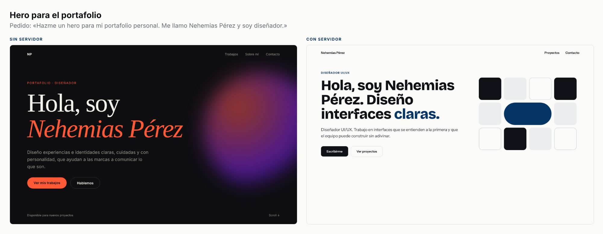
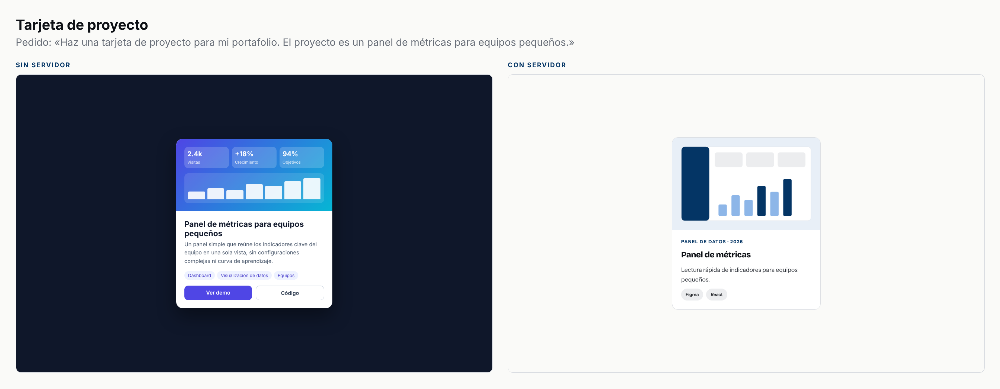

# Marca MCP: mi sistema de diseño, leído por una máquina

> **Borrador para el «Laboratorio» de nehemiasperez.com.** Está escrito en primera persona a partir de lo que ocurrió en el proyecto. Ajústelo a su voz y complete los pasajes marcados con **[Suyo]**. Los números salen de `evals/reporte.md`.

**Resumen.** Construí un servidor MCP de solo lectura con mi sistema de diseño. Ahora Claude puede leer mis colores, tipografías, componentes y reglas, y revisar si algo las respeta. En siete tareas realistas, las piezas hechas con el servidor salieron sin ningún valor fuera de los tokens. Las hechas sin él tuvieron 117.

## El problema

Cada vez que le pedía algo a una IA, repetía lo mismo: los colores, las fuentes, cómo se escribe mi título. Propuestas, CV, tarjetas, presentaciones. Los mismos párrafos de instrucciones, pegados a mano.

Y aun así fallaba en lo pequeño. Un azul parecido, pero no el mío. Una fuente de sistema. Un título en inglés. Cada pieza correcta por separado, ninguna mía.

La pregunta fue simple: ¿puedo escribir mi marca una sola vez, de forma que una máquina la entienda?

## Cómo documenté el sistema para una máquina

Un diseñador documenta para personas: una guía en PDF, un archivo de Figma. Una máquina necesita otra cosa. No entiende «un azul sobrio». Entiende `#043565`, un nombre y una regla que se pueda comprobar.

Esto fue lo que hice:

- **Tokens en formato estándar (W3C Design Tokens).** Cada token tiene un nombre, un valor y una descripción de para qué sirve. Escribir la descripción fue la parte difícil: me obligó a decidir qué hace cada color.
- **Pares de contraste declarados.** El archivo dice qué texto va sobre qué fondo. Un validador calcula el contraste y falla si un par no llega al nivel que prometí.
- **Un archivo por componente**, con la misma plantilla: para qué sirve, cuándo no usarlo, variantes, tokens, accesibilidad y código en tres formatos (HTML, React con Tailwind y CSS para PDF).
- **Reglas con identificador** (R-COLOR-2: el azul es solo acento). Un identificador se puede citar en una revisión.
- **Una voz con listas.** Las palabras que no uso, las frases de relleno y el título correcto están en viñetas que el servidor lee.

Luego lo expuse por MCP con tres primitivas:

- **Recursos**, para leer el sistema completo como contexto.
- **Herramientas**, para que el agente pregunte y revise: ¿este color está en la paleta?, ¿este código sale de los tokens?, ¿este texto respeta mi voz?
- **Prompts**, para arrancar flujos que repito: crear un componente, revisar una pantalla, armar una pieza.

## Qué aprendí como diseñador

1. **Una regla que no se puede comprobar es un deseo.** Cuando convertí las reglas en un auditor de código, mis propios componentes fallaron. Usé un radio de 5 px que no existía en mi escala. Mi página pública usó una fuente monoespaciada que no era mía. El sistema me corrigió a mí.
2. **Los nombres importan más con una máquina.** Llamé `titulo` a una familia y a un peso. En Tailwind, `font-titulo` significaba las dos cosas. Renombré el peso a `extranegrita`. Un nombre ambiguo, que una persona resuelve con el contexto, rompe una herramienta.
3. **Escribir lo implícito revela huecos.** Faltaba el fondo del aviso destacado: lo usaba, pero no existía como token. Faltaban los espaciados, los radios y las sombras. Los propuse yo; usted los aprueba o los cambia en `tokens.json`. **[Suyo: qué huecos encontró en su propio sistema.]**
4. **Un contraste que «se ve bien» puede no pasar.** El gris de texto secundario no llega a AA sobre el fondo de las etiquetas. Quedó documentado como par prohibido.
5. **Documentar para una máquina mejoró el documento para personas.** Las reglas son más cortas y más claras que las que tenía. **[Suyo: confirme o corrija esta conclusión.]**

## Resultados de la evaluación

Siete pedidos realistas, siempre los mismos, sin mencionar la marca: un hero, una tarjeta de proyecto, la portada de una propuesta, una publicación para redes, un aviso destacado, una tabla de precios y un bloque de contacto. Cada uno se pidió dos veces: sin el servidor y con él. Después medí el resultado con mis propias herramientas y un navegador.

| Métrica (menos es mejor) | Sin servidor | Con servidor |
|---|---:|---:|
| Valores fuera de los tokens en el código | 117 | 0 |
| Colores renderizados fuera de la paleta | 47 | 0 |
| Fuentes ajenas a la marca | 8 | 0 |
| Textos que no llegan a AA de contraste | 26 | 0 |
| Fallos de voz | 1 | 0 |
| Piezas sin ningún hallazgo | 0 de 7 | 7 de 7 |

Las capturas lado a lado están en [`lado-a-lado/`](lado-a-lado/). Dos ejemplos:

Lo que se ve:

- **Sin servidor, cada pieza es otra marca.** Un hero oscuro con naranja y un degradado. Una tabla en índigo y amarillo. Una tarjeta que inventó métricas que nadie pidió.
- **Con servidor, todas se reconocen como mías.** El azul solo como acento, una palabra destacada por título, el motivo de cuadros, mi título.
- **El beneficio vino de leer antes de construir.** El agente consultó tokens y componentes en las siete tareas. En cambio, la revisión posterior fue irregular: usó `revisar_texto` en cinco, `auditar_codigo` en una y `revisar_contraste` en ninguna, aunque la skill la pide.
- **Cuesta más.** Cada pieza usó unas tres veces más turnos y 2.3 veces el costo: $0.09 contra $0.04 por tarea.

**Calificación visual (1 a 5).** **[Suyo: llene `evals/calificaciones.md`, corra `npm run evals -- --solo-reporte` y cite aquí el promedio.]**

### Cómo leer estos números con cuidado

- Es una corrida por tarea. El modelo no es determinista: una diferencia pequeña puede ser ruido.
- La evaluación es en parte circular. Mido con las mismas herramientas que el agente puede usar y con los mismos tokens que copia. Mide fidelidad a los tokens, no calidad de diseño. Para eso está la calificación de mis ojos.
- La condición «con servidor» incluye la skill `/marca`. No aísla el efecto del servidor solo.

## Lo que haría distinto

- **Repetir cada tarea tres veces** y reportar el rango, no un número.
- **Probar «solo servidor» contra «servidor y skill»** para saber cuál de los dos pesa más.
- **Calificar a ciegas.** Mezclar las capturas sin etiqueta para no sesgar mi juicio.
- **Hacer obligatoria la revisión posterior** con un hook que corra `auditar_codigo` al terminar, en lugar de confiar en que el agente la pida.
- **Extraer la escala del portafolio real** en lugar de proponerla: espaciados, radios y sombras salieron de una propuesta, no de mi sitio.
- **Probar con otros modelos** y con piezas que mezclen claro y oscuro.
- **Publicar el servidor** y medir si el uso remoto cambia algo.

## Qué sigue

La página pública `/marca` ya se genera desde los mismos archivos (`sitio/publico`). Falta publicarla en el portafolio y conectar Paridad, mi comparador de diseño y código, para que lea esta paleta en lugar de una copia.

**Código y reporte completo:** el repositorio `Marca_MCP`, con `evals/reporte.md` y las capturas.
