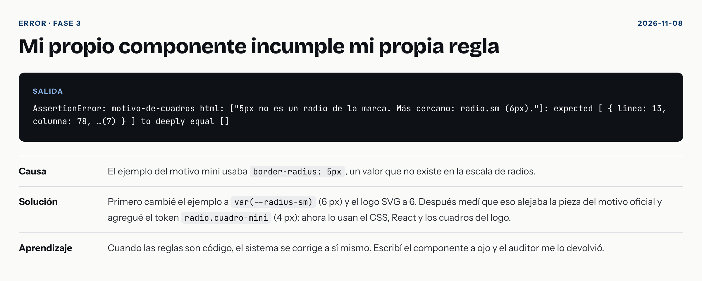
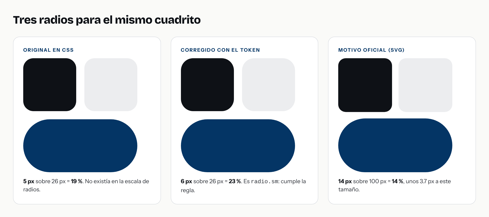

# El radio de 5 píxeles que nadie veía

> **Borrador para el «Laboratorio» de nehemiasperez.com.** Primera persona, a partir de lo que ocurrió en el proyecto Marca MCP. Ajústelo a su voz y responda los pasajes marcados con **[Suyo]**. Cada dato sale del repositorio: los commits `c1bab4f` (el error) y `63aa947` (la corrección).

**En corto.** Un cuadrito de 26 píxeles tenía un radio de 5 px que no existía en mi sistema. Nadie lo notó. Lo encontró una prueba, y al corregirlo me alejé más del diseño original. Lo resolví agregando un radio nuevo, `radio.cuadro-mini`, de 4 px.

## El problema

Mi sistema de diseño definía cinco radios: 6, 10, 14, 16 y píldora. La regla dice que todo radio sale de ahí.

En la fase 1 documenté el motivo de marca en versión mini: una rejilla de 2 × 2 con cuadros de 26 px. Escribí el CSS a ojo y puse `border-radius: 5px`. Puse el mismo 5 en el logo en SVG, dos veces.

Quedó así durante dos fases. No falló nada porque no había nada que lo revisara.

## Cómo apareció

En la fase 3 escribí el auditor de código y una prueba simple: el código de cada componente debe pasar su propia auditoría. La prueba falló. Esto devolvió el auditor sobre el archivo original (las líneas cuentan dentro de cada ejemplo de código):

```
L15:78 [error] radio: 5px no es un radio de la marca. Más cercano: radio.sm (6px). → Use var(--radius-sm).
L6:44  [error] radio: rounded-[5px] no es un radio de la marca. Más cercano: radio.sm (6px). → Use var(--radius-sm).
L7:44  [error] radio: rounded-[5px] no es un radio de la marca. Más cercano: radio.sm (6px). → Use var(--radius-sm).
```

Tres hallazgos: uno en CSS y dos en React. Una diferencia de un píxel. A simple vista, imposible de ver.



## La corrección y lo que no vi

Cambié el CSS a `var(--radius-sm)`, que son 6 px. Cambié React a `rounded-sm`. La prueba pasó.

El logo en SVG también tenía 5 px, pero el auditor no lo detectó. Lo corregí yo, a mano, porque sabía que estaba ahí. Cuando lo comprobé al escribir este caso, resultó que el auditor no miraba el atributo `rx` de un SVG: el mismo valor, en dos lugares, con uno solo vigilado.

Lo arreglé después. Ahora el auditor lee `rx` y `ry` de cada `<rect>`. Una esquina que cubre la mitad de la altura es una píldora y es válida; el resto se compara con la escala:

```
auditar_codigo(html) sobre <rect width="26" height="26" rx="5" .../>
L1:35 [error] radio: rx="5" no es un radio de la marca. Más cercano: radio.sm (6). → Use rx="6" (radio.sm), o un valor que cubra la mitad de la altura si busca una píldora.
```

Y hay algo más. Medí las versiones del mismo cuadro:



| Versión | Radio | Proporción del lado |
|---|---:|---:|
| Original en CSS | 5 px | 19 % |
| Corregido con el token existente | 6 px | 23 % |
| **Decisión: `radio.cuadro-mini`** | **4 px** | **15 %** |
| Motivo oficial (SVG) | ≈ 3.7 px | 14 % |

El motivo oficial usa un radio de 14 sobre un cuadro de 100: un 14 %. El 5 original ya era más redondo que eso. Mi corrección, para cumplir la regla, lo hizo todavía más redondo. **La prueba quedó en verde y la pieza quedó más lejos de mi propio diseño.**

## La decisión

Era una decisión de marca, no de código. Había tres caminos:

| Opción | A favor | En contra |
|---|---|---|
| **A.** Dejar 6 px | Simple. Sale de un token | Más redondo que el motivo oficial (23 % contra 14 %) |
| **B.** Calcularlo: `calc(var(--lado) * 0.14)` | Fiel al motivo a cualquier tamaño | Un número que no está en la escala |
| **C.** Un token nuevo, `radio.cuadro-mini` de 4 px | Cumple la regla y se acerca al motivo (15 %) | Un token más; hay que ajustar el logo |

**Elegí la C.** Mantiene la regla de que todo radio sale de un token y conserva la forma del motivo. Lo que cambió:

- `tokens.json`: el token `radio.cuadro-mini` (4 px), con la razón en su descripción.
- El motivo mini en CSS usa `var(--radius-cuadro-mini)` y en React, `rounded-cuadro-mini`.
- Los dos cuadros del logo pasaron de 6 a 4 px. La píldora no cambió.

Ahora los radios son seis. El auditor ya reconoce el nuevo: un `4px` escrito a mano da un aviso que apunta al token. **[Suyo: confirme que el resultado visual le convence, o explique qué ajustaría.]**

El radio del logo ya no se cuida a mano: lo vigila el auditor.

## Lo que aprendí

1. **La regla vio lo que el ojo no veía.** Un píxel. Nunca lo habría encontrado revisando a mano.
2. **Cumplir la regla no es acertar.** Una verificación en verde mide consistencia con la escala, no fidelidad al diseño. Corregí hacia el token y me alejé del original.
3. **Una verificación solo cubre donde mira.** El mismo valor estaba en dos lugares. El sistema vigilaba uno. Hoy vigila los dos.
4. **El orden importa.** El error vivió dos fases porque primero escribí el contenido y después la prueba. Con la prueba primero, lo habría atrapado el mismo día.

## Lo que haría distinto

- Escribir la prueba de coherencia antes que el primer componente.
- Que el auditor leyera `rx` y `ry` de los SVG desde el principio (ya lo hace).
- Definir los radios del motivo mini al diseñar el motivo, no al documentarlo. Esta vez faltó un token para el tamaño mini; lo agregué dos fases tarde.
- Medir la proporción contra el original antes de aplicar una corrección.

## Evidencia

- Original: `git show c1bab4f:marca/componentes/motivo-de-cuadros.md`
- Corrección: commit `63aa947`
- Registro de errores: [radio fuera de escala](../errores/2026-11-08-radio-fuera-de-escala.png), [el auditor no mira los radios de un SVG](../errores/2026-11-08-el-auditor-no-mira-los-radios-de-un-svg.png) (resuelto)
- Imagen reproducible: `npm run casos`
