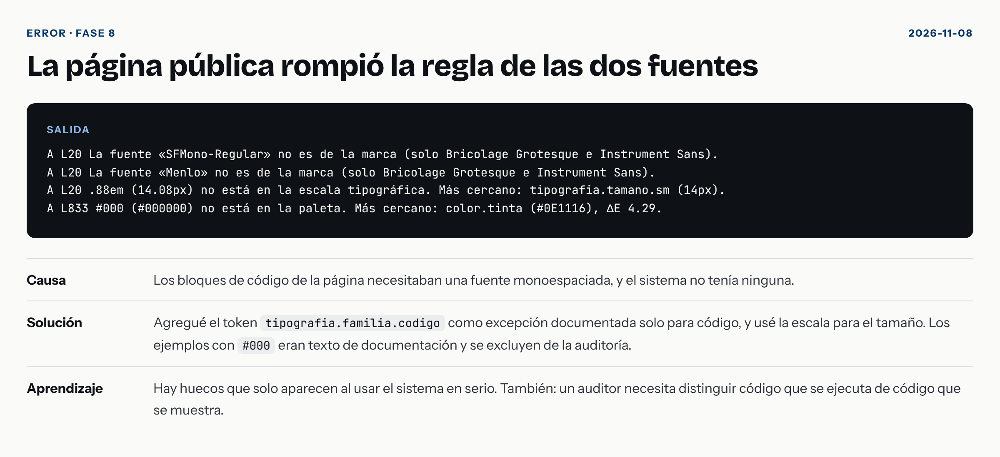
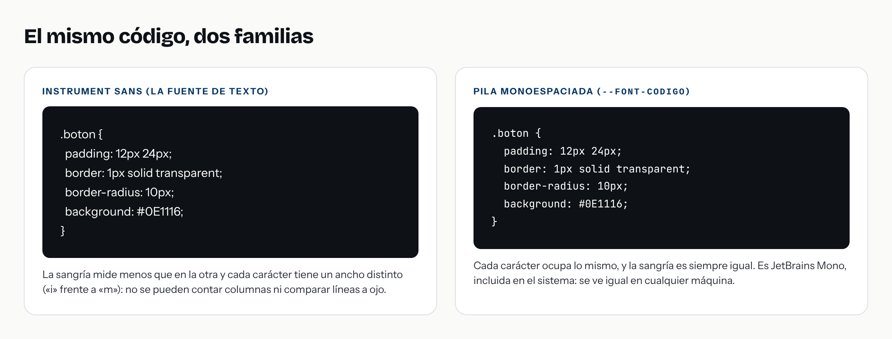
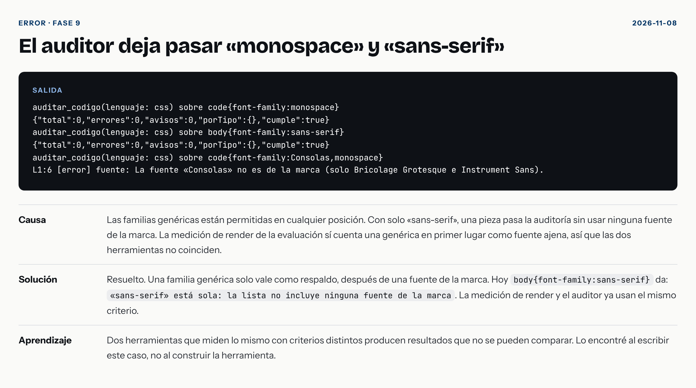

# La fuente que mi marca no tenía

> **Borrador para el «Laboratorio» de nehemiasperez.com.** Primera persona, a partir de lo que ocurrió en el proyecto Marca MCP. Ajústelo a su voz y responda los pasajes marcados con **[Suyo]**. Referencia: commit `1ce17b7`, donde quedó resuelto.

**En corto.** Mi marca tiene dos fuentes y una regla que prohíbe una tercera. Al construir la página pública necesité una para mostrar código. El sistema me lo impidió, y descubrí que le faltaba una decisión. Al resolverla encontré tres defectos más, uno de ellos mío.

## El problema

La regla R-TIPO-1 dice: dos familias, Bricolage Grotesque para títulos e Instrument Sans para todo lo demás. Ninguna otra.

En la fase 8 construí la página pública `/marca`. Muestra el código de cada componente, y el código se lee en una fuente monoespaciada. Escribí lo que escribe cualquier desarrollador por reflejo:

```css
code { font-family: ui-monospace, SFMono-Regular, Menlo, monospace; font-size: .88em; }
```

## Cómo apareció

La página debía cumplir mi propia marca, así que hay una prueba que la audita con mis herramientas. Falló con 8 errores. Tres eran reales, en esa sola regla:

```
L1:6  [error] fuente: La fuente «SFMono-Regular» no es de la marca (solo Bricolage Grotesque e Instrument Sans).
L1:6  [error] fuente: La fuente «Menlo» no es de la marca (solo Bricolage Grotesque e Instrument Sans).
L1:62 [error] tamano: .88em (14.08px) no está en la escala tipográfica. Más cercano: tipografia.tamano.sm (14px).
```



Los otros cinco eran falsos positivos. La página muestra código como texto, y el auditor no distingue el código que se ejecuta del código que se muestra. Vio `#000` en una explicación de las reglas y `font-family` dentro de un ejemplo. La solución fue excluir los bloques `<pre>` y `<code>` de la prueba. Un auditor que da falsas alarmas se deja de usar.

## Qué decidí

El sistema no tenía fuente para código. Había tres caminos:

**1. Usar Instrument Sans.** Cumple la regla, pero el código se lee mal: la sangría mide menos y cada carácter tiene un ancho distinto.



**2. Escribir solo `monospace`.** Es lo más fácil, y el auditor de entonces lo habría dejado pasar. Ese es justamente el problema: pasar la auditoría sin haber decidido nada. Cada sistema operativo pone una fuente distinta.

**3. Un token nuevo.** Lo elegí. Agregué `tipografia.familia.codigo` con una descripción que dice dos cosas: es una pila monoespaciada, y **no es una fuente de la marca visual**. No se usa en piezas de diseño. Primero fue solo la pila del sistema; después empaqueté JetBrains Mono (licencia libre) al frente de la pila, para que el código se vea igual en cualquier máquina.

La regla cambió una línea: «Única excepción: fragmentos de código en documentación, con `tipografia.familia.codigo` (JetBrains Mono, con respaldo del sistema).» Paridad, mi comparador de diseño y código, ignora ese token.

Hay un detalle que me gusta. Si alguien escribe a mano una fuente concreta de la pila, como Consolas, el auditor sigue fallando:

```
auditar_codigo(css) sobre code{font-family:Consolas,monospace}
→ [error] fuente: La fuente «Consolas» no es de la marca
```

Con `var(--font-codigo)` pasa. Las fuentes concretas solo entran a través del token.

## Lo que costó

- **Una excepción repetida en tres lugares:** el token, la regla y Paridad. Si cambio uno y olvido otro, se desfasan. Ahora hay una prueba que comprueba que los tres existen.
- **Un archivo más en el sistema:** JetBrains Mono pesa unos 21 KB. A cambio, la página se ve igual en un Mac, en Windows y en Linux.

## Lo que encontré al escribir este caso (y al arreglarlo)

Cuatro hallazgos, todos en el registro de errores.

**1. El auditor dejaba pasar `sans-serif` y `monospace` como única familia.** Una pieza sin ninguna fuente de la marca pasaba la auditoría. Y no coincidía con otra de mis herramientas: la medición de la evaluación, que mira lo que se renderiza, sí contaba una genérica en primer lugar como fuente ajena. En la evaluación, sin servidor, `system-ui` apareció como primera familia en cinco de las siete tareas.



Ahora una genérica solo vale como respaldo, después de una fuente de la marca:

```
auditar_codigo(css) sobre body{font-family:sans-serif}
L1:6 [error] fuente: «sans-serif» está sola: la lista no incluye ninguna fuente de la marca (Bricolage Grotesque o Instrument Sans). Una genérica solo vale como respaldo.
```

Con `font-family: "Instrument Sans", sans-serif` pasa.

**2. El auditor solo leía la primera fuente si la lista empezaba con comillas.** Lo descubrí al probar el punto anterior. `"Instrument Sans", Arial` pasaba sin hallazgo, porque la expresión capturaba solo `Instrument Sans`. Existía desde que escribí el auditor.

**3. Mi corrección rompió un caso.** Al arreglar el punto 2, el atributo de un SVG, `font-family="'Bricolage Grotesque', 'Instrument Sans'"`, se leía con una comilla sobrante. Lo atrapó volver a medir las salidas guardadas de la evaluación: una pieza «con servidor» que cumplía apareció con un error. El total «sin servidor» también cambió, de 117 a 130, porque el auditor ahora es más estricto. Con las mismas salidas.

**4. El auditor marcaba la fuente que el sistema incluye.** Al empaquetar JetBrains Mono, el `@font-face` que la carga se leía como uso de una fuente ajena. Ahora distingue declarar de usar.

## Lo que aprendí

1. **El sistema tenía un hueco que solo apareció al usarlo.** No lo vi al diseñarlo. Lo vi al construir una página.
2. **Una excepción explícita es mejor que una prohibición ciega.** La regla «ninguna otra» era demasiado simple. La versión nueva dice dónde se rompe y por qué.
3. **Un auditor tiene que distinguir lo que ejecuta de lo que muestra.** Sin eso, sus alarmas pierden valor.
4. **Dos herramientas que miden lo mismo con criterios distintos no se pueden comparar.** Yo las estaba comparando en el reporte. Hoy usan el mismo criterio.
5. **Cada arreglo se prueba con las formas reales de uso.** Mi primer arreglo pasaba sus pruebas y rompió un SVG real. Conservar las salidas de la evaluación me permitió verlo.

## Lo que haría distinto

- Incluir una fuente para código en el sistema desde el primer día (hoy está).
- Que el auditor permitiera las genéricas solo como respaldo desde el principio (hoy lo hace).
- Probar la página en tres sistemas operativos. **[Suyo: queda pendiente; yo solo pude verla en Linux.]**
- Escribir las pruebas del auditor con listas reales de `font-family` (con comillas, con `!important`, como atributo de SVG) antes de tocar la expresión regular.

## Evidencia

- Resolución: commit `1ce17b7`
- Registro de errores: [fuente monoespaciada](../errores/2026-11-08-fuente-monoespaciada.png), [el auditor deja pasar monospace y sans-serif](../errores/2026-11-08-el-auditor-deja-pasar-monospace-y-sans-serif.png), [solo leía la primera fuente](../errores/2026-11-08-el-auditor-solo-leia-la-primera-fuente-si-la-lis.png), [mi corrección rompió un SVG](../errores/2026-11-08-mi-correccion-rompio-el-atributo-font-family-de-.png), [marcaba la fuente que el sistema incluye](../errores/2026-11-08-el-auditor-marcaba-como-ajena-la-fuente-que-el-s.png)
- Imagen reproducible: `npm run casos`
