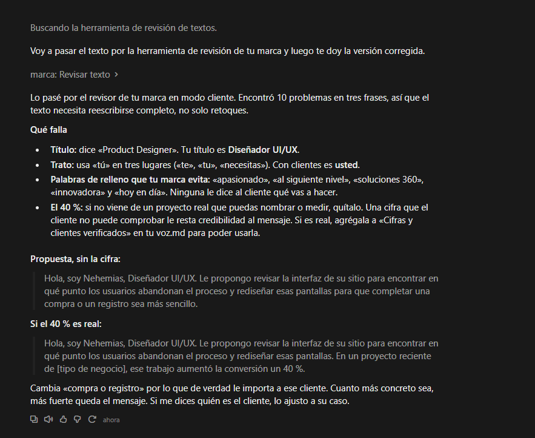
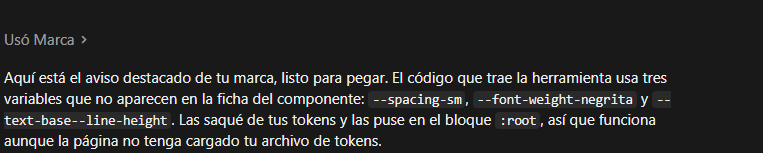

# Recorrido: una propuesta para una pyme, con Claude Desktop

Un caso de uso de principio a fin, con la salida real de cada llamada al servidor. Un cliente le pidió rediseñar su panel de métricas y usted prepara la propuesta.

> **Qué es cada captura.** Cada imagen dibuja una llamada al servidor con **la salida real** que devolvió; las genera `npm run recorrido`. **No son capturas de la interfaz de Claude Desktop**: desde este entorno no se puede abrir. Lo que Claude haría en cada paso es el flujo esperado, no una grabación. Las dos capturas reales de la interfaz son las de la sección «Prueba real en Claude Desktop».

## Antes de empezar
1. Compile el servidor: `npm run build`.
2. Agregue el servidor a `claude_desktop_config.json` con la ruta absoluta a `dist/stdio.js` (los pasos para macOS y Windows están en el [README](../README.md)).
3. Reinicie Claude Desktop por completo.

## El pedido
Usted escribe en Claude Desktop:

> *Prepárame la portada y el texto de presentación de una propuesta de rediseño de panel para una pyme. Usa mi marca y revisa el resultado con tus herramientas.*

La última frase importa: en la evaluación, un agente al que solo se le pedía la revisión en una skill la omitió con frecuencia. En Claude Desktop no hay hook que la obligue.

## Prueba real en Claude Desktop
Estas son las dos únicas capturas de la interfaz real. Se hicieron en Windows, con el servidor conectado por stdio.

### Primera prueba: revisar un texto
Se usó el texto del paso 5.



**Qué confirma**
- Claude Desktop reconoció el servidor y llamó a **«marca: Revisar texto»**, una sola vez.
- Contó 10 problemas, que son los 8 errores y 2 avisos de la llamada 5.
- Agrupó lo que encontró: el título, el trato de «tú» en tres lugares, las palabras de relleno y la cifra del 40 %.

**Qué mostró**
- Claude propuso dos versiones corregidas, pero **no volvió a llamar a la herramienta** para revisarlas. Después se revisaron con el servidor: la primera no tiene hallazgos y la segunda solo trae el aviso de la cifra del 40 %, que Claude mismo pidió verificar. Acertó, pero sin comprobarlo.
- Es la misma omisión que se vio en la evaluación con Claude Code. Por eso conviene pedir la revisión de la versión corregida en el mensaje.

### Segunda prueba: pedir un componente
Se pidió el componente de aviso destacado en HTML.



**Qué confirma**
- Claude Desktop usó el servidor (la captura dice «Usó Marca» sin detallar qué herramienta; por su texto, usó el código que devuelve la herramienta del componente).
- Entregó el HTML y el CSS completos, y puso en un bloque `:root` las variables de los tokens, así que el código funciona aunque la página no cargue el archivo de tokens.
- El código que entregó pasa la revisión sin hallazgos.

**Lo que encontró, y era un defecto real**
Claude advirtió que el código del componente usaba tres variables que no aparecían en la ficha: `--spacing-sm`, `--font-weight-negrita` y `--text-base--line-height`. Era cierto. Al comprobarlo en los nueve componentes, ocho usaban variables que su ficha no declaraba, 43 en total. La ficha del aviso decía además que la separación entre título y texto usaba `espaciado.md`, pero el código usa `espaciado.sm`. Se corrigieron las fichas y una prueba comprueba ahora que todo lo que usa el código esté declarado.

## Las llamadas

### 1. Claude busca el componente
Pregunta por una portada de propuesta y obtiene tres candidatos. El primero, `portada-de-documento`, coincide en un 67 %.


### 2. Lee el componente elegido
Recibe para qué sirve, cuándo no usarlo, variantes, tokens, accesibilidad y el código en HTML. La captura muestra el comienzo; el resto de la salida no se dibuja.


### 3. Carga los colores
En lugar de escribir los colores de memoria, pide los tokens de color.


### 4. Pide el motivo
Obtiene el SVG del motivo de cuadros en vez de redibujarlo.


Con esas cuatro llamadas, Claude arma la portada con sus colores, fuentes y motivo.

### 5. Usted pega su texto antiguo
Un borrador típico, revisado como texto para un cliente. La herramienta devuelve **8 errores y 2 avisos**: el título incorrecto, palabras de relleno, el trato de «tú» y una cifra por verificar. No reescribe nada: solo señala.


### 6. Claude lo corrige y vuelve a revisar
La versión corregida pasa sin hallazgos. En la prueba real, Claude propuso la corrección pero no volvió a llamar a la herramienta; aquí se muestra esa revisión, que hay que pedir.


### 7. Una duda de color
¿Se puede poner el gris de apoyo sobre las etiquetas? El servidor calcula el contraste y avisa que ese par está prohibido por la marca.


### 8. Claude audita su primer CSS
Un CSS escrito a ojo falla en la fuente, el tamaño de letra, el color y el radio. Cada hallazgo trae la línea y el token que corresponde.


### 9. Corrige con los tokens y vuelve a auditar
Con las variables de los tokens, el CSS no tiene hallazgos.


## Qué cambia respecto a Claude Code
- **No hay hook ni skill `/marca` en Claude Desktop.** Son funciones de Claude Code. Nada obliga a Claude a verificar: pídaselo en su mensaje.
- **Los prompts del servidor** (`crear_componente`, `revisar_pantalla`, `pieza_de_marca`) arman el contexto completo en un paso. No se comprobó cómo se muestran en la interfaz de Claude Desktop.
- **`auditar_codigo` recibe el código como texto.** En una conversación, Claude ya lo tiene, así que revisar un fragmento cuesta una sola llamada.
- **Guardar archivos** depende de lo que Claude Desktop le permita hacer en su máquina. El servidor no escribe nada: es de solo lectura.

## Lo que no se probó
Con Claude Desktop se hicieron **dos pruebas**: `revisar_texto` y el pedido de un componente (la captura no muestra qué herramienta se usó). Las demás herramientas, los recursos y los prompts no se han probado desde Desktop. Por stdio deberían funcionar igual. Tampoco se comprobó cómo se muestran los prompts en su interfaz.

## Para regenerar las capturas
```bash
npm run recorrido
```
Ejecuta las nueve llamadas contra el servidor, dibuja las tarjetas en `caso-de-estudio/recorrido/capturas/` y guarda las salidas en `salidas.json`. Una prueba comprueba que las capturas y este documento sigan coincidiendo con lo que devuelve el servidor.
