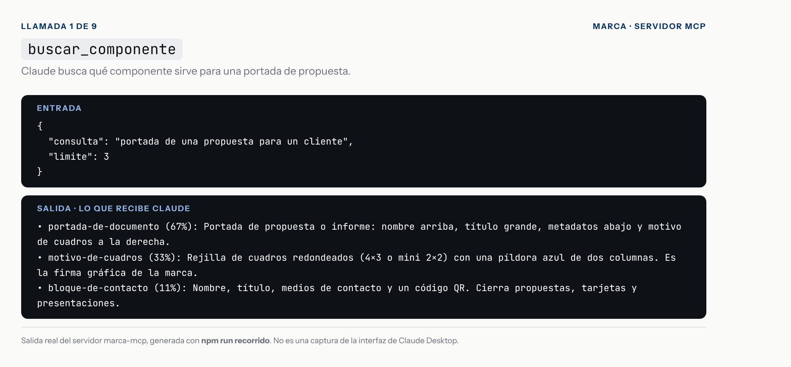
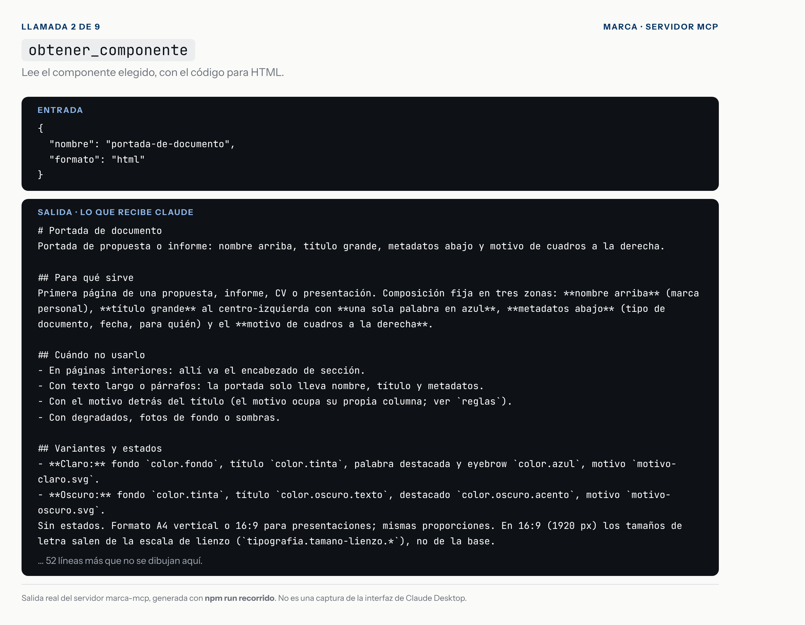
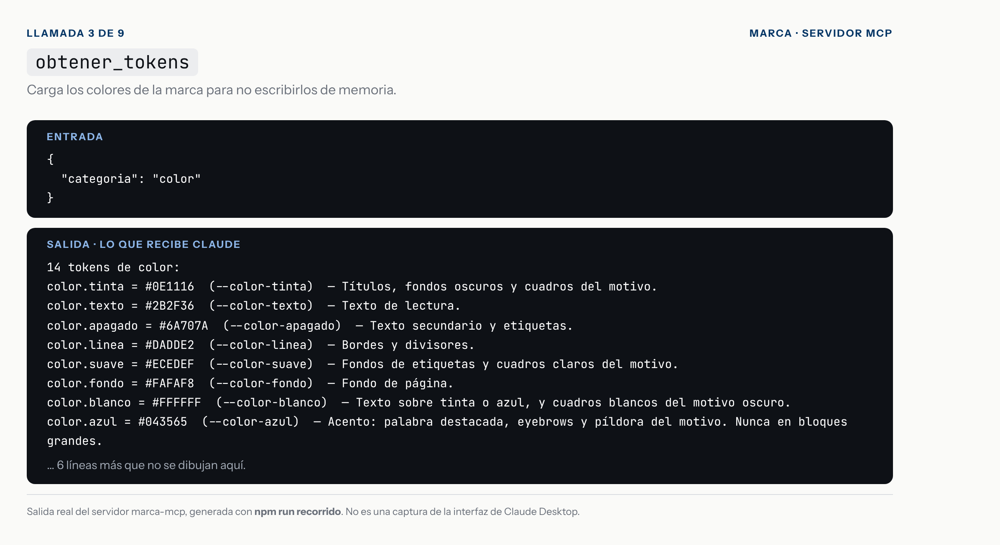
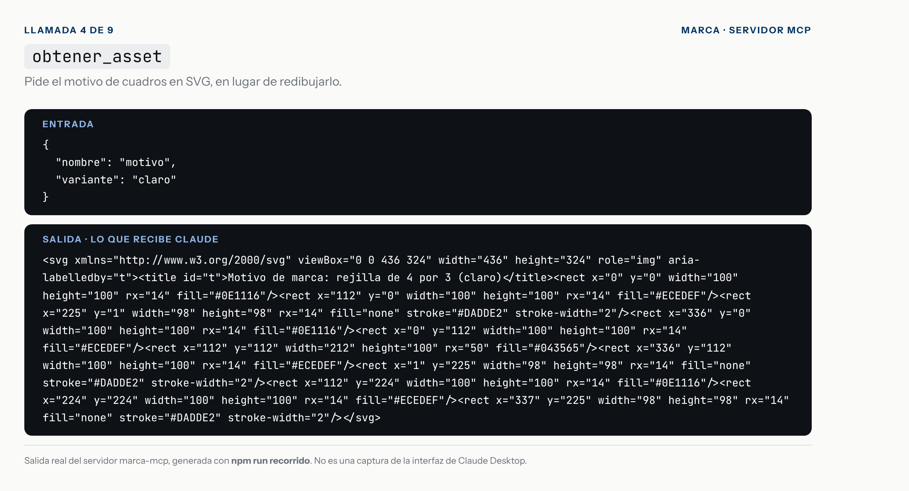
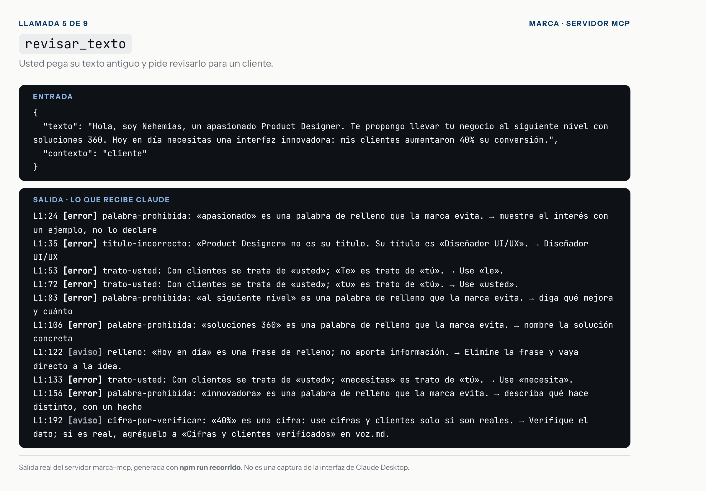
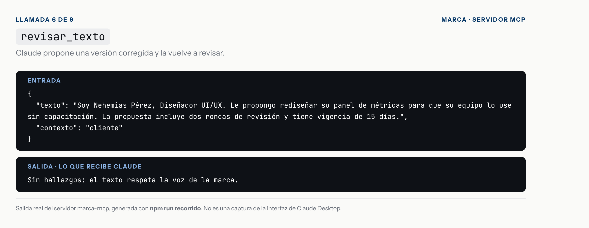
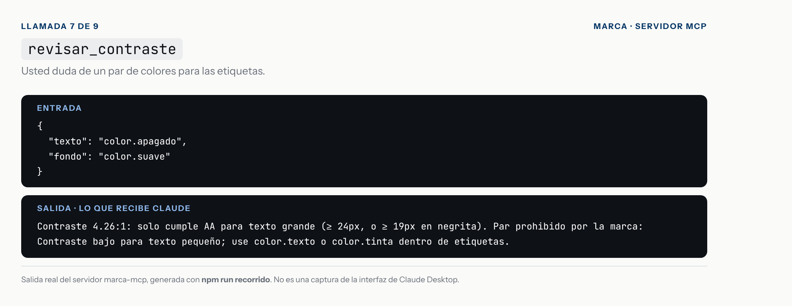
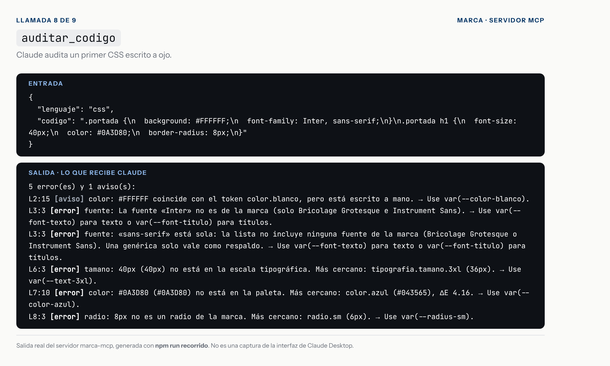
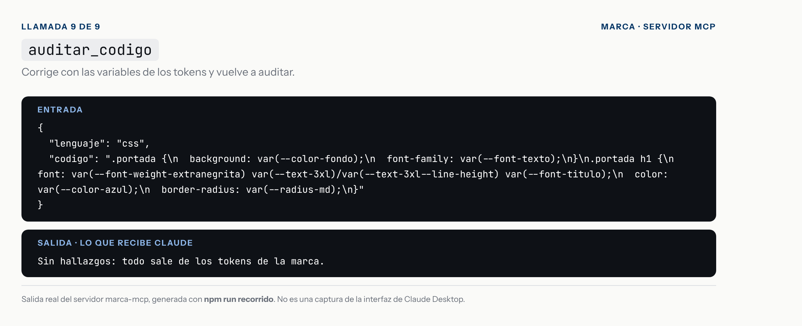

# Recorrido: una propuesta para una pyme, con Claude Desktop

Un caso de uso de principio a fin, con la salida real de cada llamada al servidor. Un cliente le pidió rediseñar su panel de métricas y usted prepara la propuesta.

> **Qué es cada captura.** Cada imagen dibuja una llamada al servidor con **la salida real** que devolvió; las genera `npm run recorrido`. **No son capturas de la interfaz de Claude Desktop**: desde este entorno no se puede abrir. Lo que Claude haría en cada paso es el flujo esperado, no una grabación.

## Antes de empezar
1. Compile el servidor: `npm run build`.
2. Agregue el servidor a `claude_desktop_config.json` con la ruta absoluta a `dist/stdio.js` (los pasos para macOS y Windows están en el [README](../README.md)).
3. Reinicie Claude Desktop por completo.

## El pedido
Usted escribe en Claude Desktop:

> *Prepárame la portada y el texto de presentación de una propuesta de rediseño de panel para una pyme. Usa mi marca y revisa el resultado con tus herramientas.*

La última frase importa: en la evaluación, un agente al que solo se le pedía la revisión en una skill la omitió con frecuencia. En Claude Desktop no hay hook que la obligue.

## Las llamadas

### 1. Claude busca el componente
Pregunta por una portada de propuesta y obtiene tres candidatos. El primero, `portada-de-documento`, coincide en un 67 %.



### 2. Lee el componente elegido
Recibe para qué sirve, cuándo no usarlo, variantes, tokens, accesibilidad y el código en HTML. La captura muestra el comienzo; el resto de la salida no se dibuja.



### 3. Carga los colores
En lugar de escribir los colores de memoria, pide los tokens de color.



### 4. Pide el motivo
Obtiene el SVG del motivo de cuadros en vez de redibujarlo.



Con esas cuatro llamadas, Claude arma la portada con sus colores, fuentes y motivo.

### 5. Usted pega su texto antiguo
Un borrador típico, revisado como texto para un cliente. La herramienta devuelve **8 errores y 2 avisos**: el título incorrecto, palabras de relleno, el trato de «tú» y una cifra por verificar. No reescribe nada: solo señala.



### 6. Claude lo corrige y vuelve a revisar
La versión corregida pasa sin hallazgos.



### 7. Una duda de color
¿Se puede poner el gris de apoyo sobre las etiquetas? El servidor calcula el contraste y avisa que ese par está prohibido por la marca.



### 8. Claude audita su primer CSS
Un CSS escrito a ojo falla en la fuente, el tamaño de letra, el color y el radio. Cada hallazgo trae la línea y el token que corresponde.



### 9. Corrige con los tokens y vuelve a auditar
Con las variables de los tokens, el CSS no tiene hallazgos.



## Qué cambia respecto a Claude Code
- **No hay hook ni skill `/marca` en Claude Desktop.** Son funciones de Claude Code. Nada obliga a Claude a verificar: pídaselo en su mensaje.
- **Los prompts del servidor** (`crear_componente`, `revisar_pantalla`, `pieza_de_marca`) arman el contexto completo en un paso. No se comprobó cómo se muestran en la interfaz de Claude Desktop.
- **`auditar_codigo` recibe el código como texto.** En una conversación, Claude ya lo tiene, así que revisar un fragmento cuesta una sola llamada.
- **Guardar archivos** depende de lo que Claude Desktop le permita hacer en su máquina. El servidor no escribe nada: es de solo lectura.

## Lo que no se probó
Este servidor nunca se abrió desde Claude Desktop. Se probó con el MCP Inspector, con un cliente MCP en las pruebas automáticas y con Claude Code en modo no interactivo. Por stdio debería funcionar igual, pero lo confirma quien lo conecte.

## Para regenerar las capturas
```bash
npm run recorrido
```
Ejecuta las nueve llamadas contra el servidor, dibuja las tarjetas en `caso-de-estudio/recorrido/capturas/` y guarda las salidas en `salidas.json`. Una prueba comprueba que las capturas y este documento sigan coincidiendo con lo que devuelve el servidor.
