# Registro de errores

Errores reales del proyecto, con su captura, causa, solución y aprendizaje: material para casos de estudio del portafolio.
Se agregan con `npm run error -- --titulo="…" --salida="…"` (ver `errores.ts`).

| # | Fase | Error | Fecha |
|---|---|---|---|
| 1 | 1 | [Un componente apunta a un token que no existe](#2026-11-08-token-inexistente) | 2026-11-08 |
| 2 | 3 | [Mi propio componente incumple mi propia regla](#2026-11-08-radio-fuera-de-escala) | 2026-11-08 |
| 3 | 8 | [La página pública rompió la regla de las dos fuentes](#2026-11-08-fuente-monoespaciada) | 2026-11-08 |
| 4 | 1 | [`font-titulo` significaba dos cosas](#2026-11-08-nombre-ambiguo) | 2026-11-08 |
| 5 | 1 | [Un par de colores que «se ve bien» no pasa AA](#2026-11-08-contraste-apagado-suave) | 2026-11-08 |
| 6 | 6 | [La medición falló dentro del navegador](#2026-11-08-playwright-name) | 2026-11-08 |
| 7 | 3 | [`revisar_texto` contaba dos veces la misma frase](#2026-11-08-voz-duplicada) | 2026-11-08 |
| 8 | 7 | [Rechazaba un host que sí estaba permitido](#2026-11-08-host-sin-cabecera) | 2026-11-08 |
| 9 | 6 | [El agente se saltó la revisión que la skill pedía como obligatoria](#2026-11-08-skill-ignorada) | 2026-11-08 |
| 10 | 9 | [Un script de apoyo falló por el formato de módulo](#2026-11-08-un-script-de-apoyo-fallo-por-el-formato-de-modul) | 2026-11-08 |
| 11 | 9 | [El auditor no mira los radios de un SVG](#2026-11-08-el-auditor-no-mira-los-radios-de-un-svg) | 2026-11-08 |
| 12 | 9 | [El auditor deja pasar «monospace» y «sans-serif»](#2026-11-08-el-auditor-deja-pasar-monospace-y-sans-serif) | 2026-11-08 |
| 13 | 9 | [El auditor solo leía la primera fuente si la lista empezaba con comillas](#2026-11-08-el-auditor-solo-leia-la-primera-fuente-si-la-lis) | 2026-11-08 |
| 14 | 9 | [Mi corrección rompió el atributo font-family de un SVG](#2026-11-08-mi-correccion-rompio-el-atributo-font-family-de-) | 2026-11-08 |
| 15 | 9 | [El auditor marcaba como ajena la fuente que el sistema incluye](#2026-11-08-el-auditor-marcaba-como-ajena-la-fuente-que-el-s) | 2026-11-08 |
| 16 | 9 | [El auditor no veía un radio al final de un atributo style](#2026-11-08-el-auditor-no-veia-un-radio-al-final-de-un-atrib) | 2026-11-08 |
| 17 | 9 | [Mi métrica contó como negro el texto blanco de un SVG](#2026-11-08-mi-metrica-conto-como-negro-el-texto-blanco-de-u) | 2026-11-08 |
| 18 | 9 | [La skill reforzada no cambió lo que hace el agente](#2026-11-08-la-skill-reforzada-no-cambio-lo-que-hace-el-agen) | 2026-11-08 |
| 19 | 9 | [Un comando mío fue bloqueado por una comprobación de seguridad](#2026-11-08-un-comando-mio-fue-bloqueado-por-una-comprobacio) | 2026-11-08 |
| 20 | 9 | [Un script falló porque faltaba la carpeta .claude](#2026-11-08-un-script-fallo-porque-faltaba-la-carpeta-claude) | 2026-11-08 |

## Un componente apunta a un token que no existe 

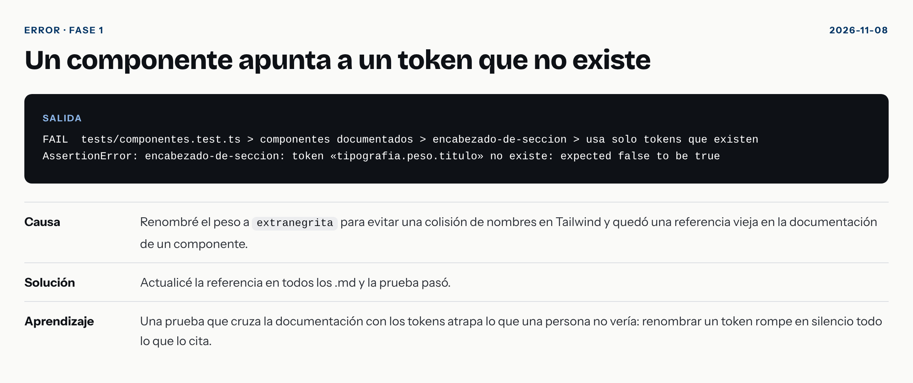

- **Causa:** Renombré el peso a `extranegrita` para evitar una colisión de nombres en Tailwind y quedó una referencia vieja en la documentación de un componente.
- **Solución:** Actualicé la referencia en todos los .md y la prueba pasó.
- **Aprendizaje:** Una prueba que cruza la documentación con los tokens atrapa lo que una persona no vería: renombrar un token rompe en silencio todo lo que lo cita.

## Mi propio componente incumple mi propia regla 

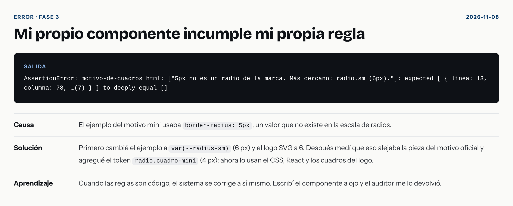

- **Causa:** El ejemplo del motivo mini usaba `border-radius: 5px`, un valor que no existe en la escala de radios.
- **Solución:** Primero cambié el ejemplo a `var(--radius-sm)` (6 px) y el logo SVG a 6. Después medí que eso alejaba la pieza del motivo oficial y agregué el token `radio.cuadro-mini` (4 px): ahora lo usan el CSS, React y los cuadros del logo.
- **Aprendizaje:** Cuando las reglas son código, el sistema se corrige a sí mismo. Escribí el componente a ojo y el auditor me lo devolvió.

## La página pública rompió la regla de las dos fuentes 

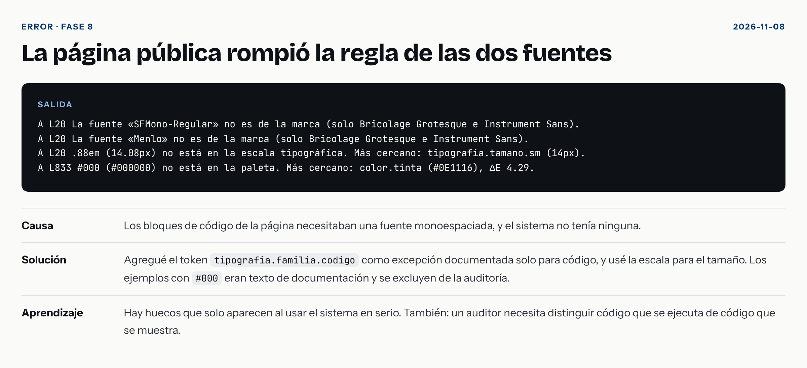

- **Causa:** Los bloques de código de la página necesitaban una fuente monoespaciada, y el sistema no tenía ninguna.
- **Solución:** Agregué el token `tipografia.familia.codigo` como excepción documentada solo para código, y usé la escala para el tamaño. Los ejemplos con `#000` eran texto de documentación y se excluyen de la auditoría.
- **Aprendizaje:** Hay huecos que solo aparecen al usar el sistema en serio. También: un auditor necesita distinguir código que se ejecuta de código que se muestra.

## `font-titulo` significaba dos cosas 

- **Causa:** Llamé `titulo` a una familia tipográfica y a un peso. Una persona lo resuelve con el contexto; Tailwind no.
- **Solución:** Renombré el peso a `extranegrita` y actualicé los componentes.
- **Aprendizaje:** Los nombres de un sistema para máquinas deben ser únicos entre categorías, no solo dentro de cada una.

## Un par de colores que «se ve bien» no pasa AA 

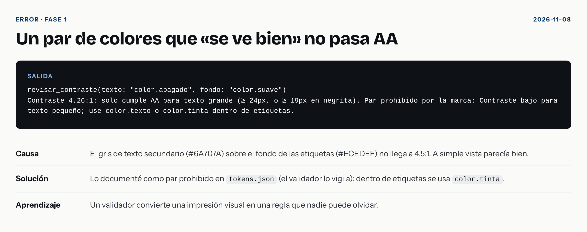

- **Causa:** El gris de texto secundario (#6A707A) sobre el fondo de las etiquetas (#ECEDEF) no llega a 4.5:1. A simple vista parecía bien.
- **Solución:** Lo documenté como par prohibido en `tokens.json` (el validador lo vigila): dentro de etiquetas se usa `color.tinta`.
- **Aprendizaje:** Un validador convierte una impresión visual en una regla que nadie puede olvidar.

## La medición falló dentro del navegador 

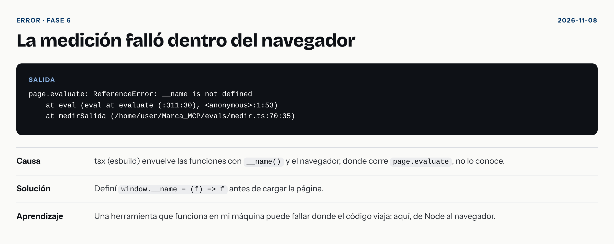

- **Causa:** tsx (esbuild) envuelve las funciones con `__name()` y el navegador, donde corre `page.evaluate`, no lo conoce.
- **Solución:** Definí `window.__name = (f) => f` antes de cargar la página.
- **Aprendizaje:** Una herramienta que funciona en mi máquina puede fallar donde el código viaja: aquí, de Node al navegador.

## `revisar_texto` contaba dos veces la misma frase 

- **Causa:** «siguiente nivel» y «al siguiente nivel» están en la lista y se solapan: una misma frase generaba dos hallazgos.
- **Solución:** Dentro de cada regla, un fragmento que se solapa con otro se cuenta una vez: gana el más largo.
- **Aprendizaje:** Un revisor ruidoso se deja de usar. Reducir falsos duplicados importa tanto como detectar.

## Rechazaba un host que sí estaba permitido 

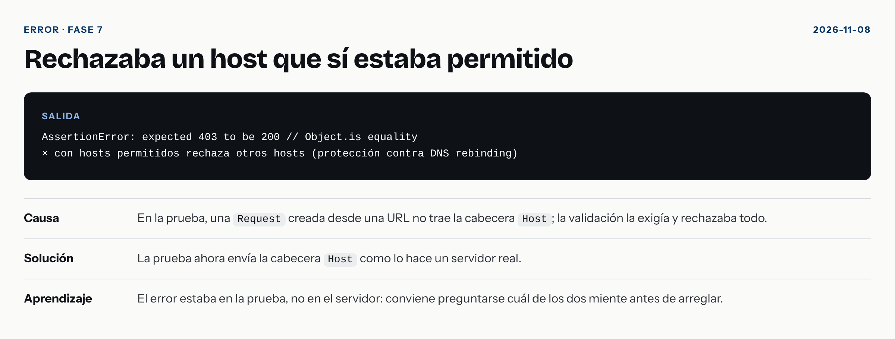

- **Causa:** En la prueba, una `Request` creada desde una URL no trae la cabecera `Host`; la validación la exigía y rechazaba todo.
- **Solución:** La prueba ahora envía la cabecera `Host` como lo hace un servidor real.
- **Aprendizaje:** El error estaba en la prueba, no en el servidor: conviene preguntarse cuál de los dos miente antes de arreglar.

## El agente se saltó la revisión que la skill pedía como obligatoria 

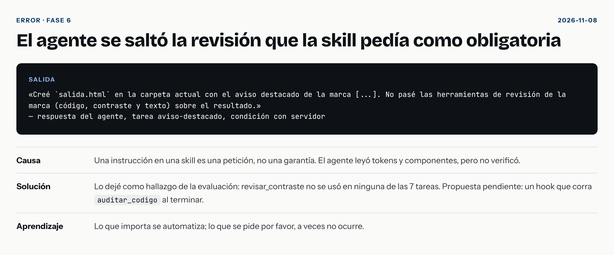

- **Causa:** Una instrucción en una skill es una petición, no una garantía. El agente leyó tokens y componentes, pero no verificó.
- **Solución:** Lo dejé como hallazgo de la evaluación: revisar_contraste no se usó en ninguna de las 7 tareas. Propuesta pendiente: un hook que corra `auditar_codigo` al terminar.
- **Aprendizaje:** Lo que importa se automatiza; lo que se pide por favor, a veces no ocurre.

## Un script de apoyo falló por el formato de módulo 

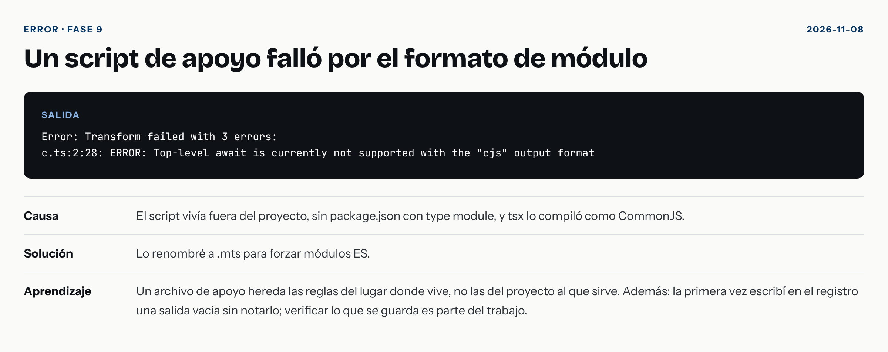

- **Causa:** El script vivía fuera del proyecto, sin package.json con type module, y tsx lo compiló como CommonJS.
- **Solución:** Lo renombré a .mts para forzar módulos ES.
- **Aprendizaje:** Un archivo de apoyo hereda las reglas del lugar donde vive, no las del proyecto al que sirve. Además: la primera vez escribí en el registro una salida vacía sin notarlo; verificar lo que se guarda es parte del trabajo.

## El auditor no mira los radios de un SVG 

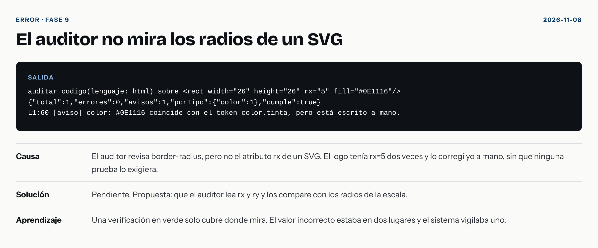

- **Causa:** El auditor revisa border-radius, pero no el atributo rx de un SVG. El logo tenía rx=5 dos veces y lo corregí yo a mano, sin que ninguna prueba lo exigiera.
- **Solución:** Resuelto. El auditor lee `rx` y `ry` de cada `<rect>`: una esquina que cubre la mitad de la altura es una píldora (válida) y el resto se compara con la escala de radios. Hoy da: `L1:35 [error] radio: rx="5" no es un radio de la marca. Más cercano: radio.sm (6).`
- **Aprendizaje:** Una verificación en verde solo cubre donde mira. El valor incorrecto estaba en dos lugares y el sistema vigilaba uno.

## El auditor deja pasar «monospace» y «sans-serif» 

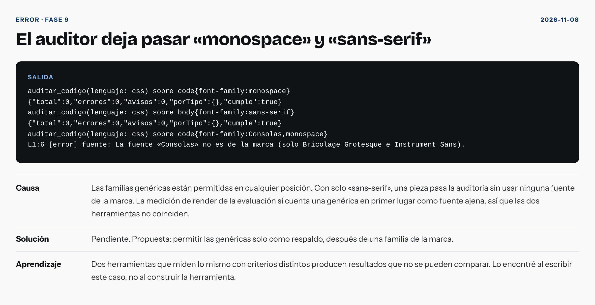

- **Causa:** Las familias genéricas están permitidas en cualquier posición. Con solo «sans-serif», una pieza pasa la auditoría sin usar ninguna fuente de la marca. La medición de render de la evaluación sí cuenta una genérica en primer lugar como fuente ajena, así que las dos herramientas no coinciden.
- **Solución:** Resuelto. Una familia genérica solo vale como respaldo, después de una fuente de la marca. Hoy `body{font-family:sans-serif}` da: `«sans-serif» está sola: la lista no incluye ninguna fuente de la marca`. La medición de render y el auditor ya usan el mismo criterio.
- **Aprendizaje:** Dos herramientas que miden lo mismo con criterios distintos producen resultados que no se pueden comparar. Lo encontré al escribir este caso, no al construir la herramienta.

## El auditor solo leía la primera fuente si la lista empezaba con comillas 

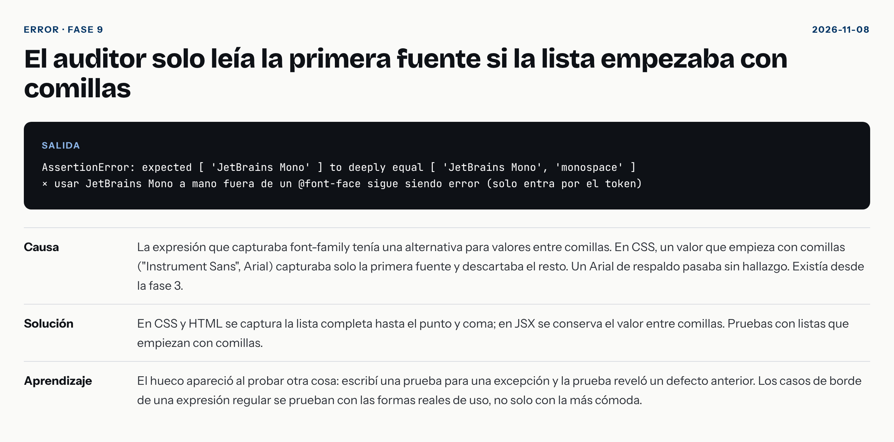

- **Causa:** La expresión que capturaba font-family tenía una alternativa para valores entre comillas. En CSS, un valor que empieza con comillas ("Instrument Sans", Arial) capturaba solo la primera fuente y descartaba el resto. Un Arial de respaldo pasaba sin hallazgo. Existía desde la fase 3.
- **Solución:** En CSS y HTML se captura la lista completa hasta el punto y coma; en JSX se conserva el valor entre comillas. Pruebas con listas que empiezan con comillas.
- **Aprendizaje:** El hueco apareció al probar otra cosa: escribí una prueba para una excepción y la prueba reveló un defecto anterior. Los casos de borde de una expresión regular se prueban con las formas reales de uso, no solo con la más cómoda.

## Mi corrección rompió el atributo font-family de un SVG 

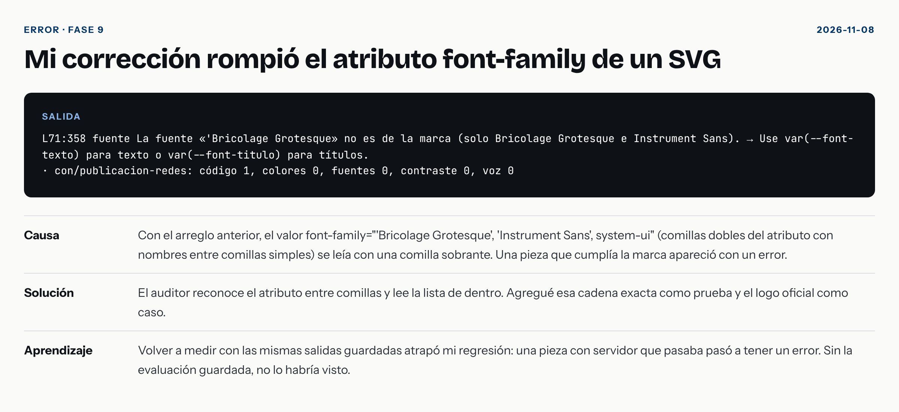

- **Causa:** Con el arreglo anterior, el valor font-family="'Bricolage Grotesque', 'Instrument Sans', system-ui" (comillas dobles del atributo con nombres entre comillas simples) se leía con una comilla sobrante. Una pieza que cumplía la marca apareció con un error.
- **Solución:** El auditor reconoce el atributo entre comillas y lee la lista de dentro. Agregué esa cadena exacta como prueba y el logo oficial como caso.
- **Aprendizaje:** Volver a medir con las mismas salidas guardadas atrapó mi regresión: una pieza con servidor que pasaba pasó a tener un error. Sin la evaluación guardada, no lo habría visto.

## El auditor marcaba como ajena la fuente que el sistema incluye 

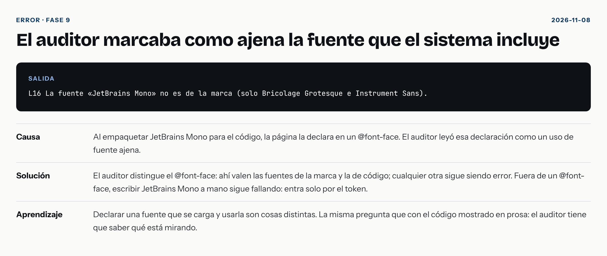

- **Causa:** Al empaquetar JetBrains Mono para el código, la página la declara en un @font-face. El auditor leyó esa declaración como un uso de fuente ajena.
- **Solución:** El auditor distingue el @font-face: ahí valen las fuentes de la marca y la de código; cualquier otra sigue siendo error. Fuera de un @font-face, escribir JetBrains Mono a mano sigue fallando: entra solo por el token.
- **Aprendizaje:** Declarar una fuente que se carga y usarla son cosas distintas. La misma pregunta que con el código mostrado en prosa: el auditor tiene que saber qué está mirando.

## El auditor no veía un radio al final de un atributo style 

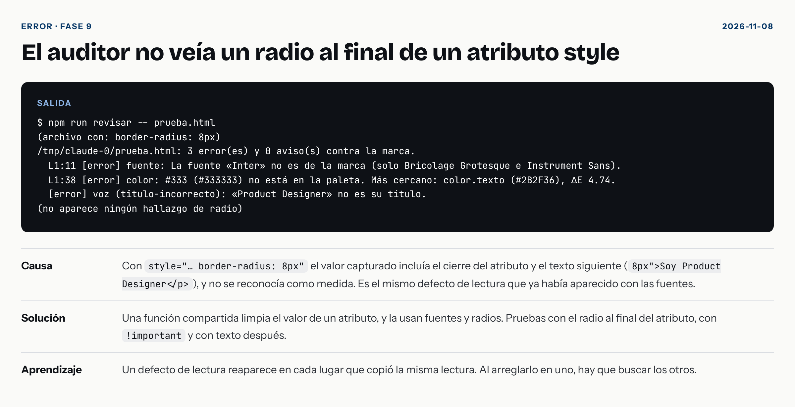

- **Causa:** Con `style="… border-radius: 8px"` el valor capturado incluía el cierre del atributo y el texto siguiente (`8px">Soy Product Designer
`), y no se reconocía como medida. Es el mismo defecto de lectura que ya había aparecido con las fuentes.
- **Solución:** Una función compartida limpia el valor de un atributo, y la usan fuentes y radios. Pruebas con el radio al final del atributo, con `!important` y con texto después.
- **Aprendizaje:** Un defecto de lectura reaparece en cada lugar que copió la misma lectura. Al arreglarlo en uno, hay que buscar los otros.

## Mi métrica contó como negro el texto blanco de un SVG 

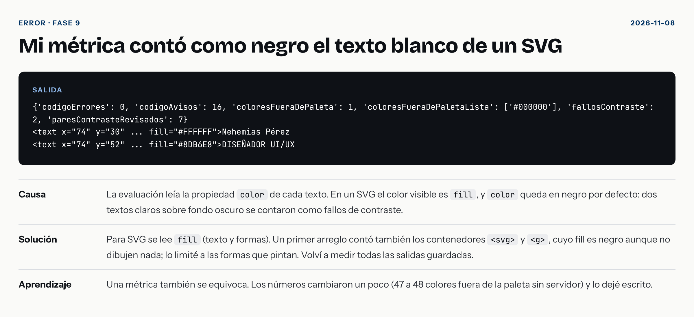

- **Causa:** La evaluación leía la propiedad `color` de cada texto. En un SVG el color visible es `fill`, y `color` queda en negro por defecto: dos textos claros sobre fondo oscuro se contaron como fallos de contraste.
- **Solución:** Para SVG se lee `fill` (texto y formas). Un primer arreglo contó también los contenedores `<svg>` y `<g>`, cuyo fill es negro aunque no dibujen nada; lo limité a las formas que pintan. Volví a medir todas las salidas guardadas.
- **Aprendizaje:** Una métrica también se equivoca. Los números cambiaron un poco (47 a 48 colores fuera de la paleta sin servidor) y lo dejé escrito.

## La skill reforzada no cambió lo que hace el agente 

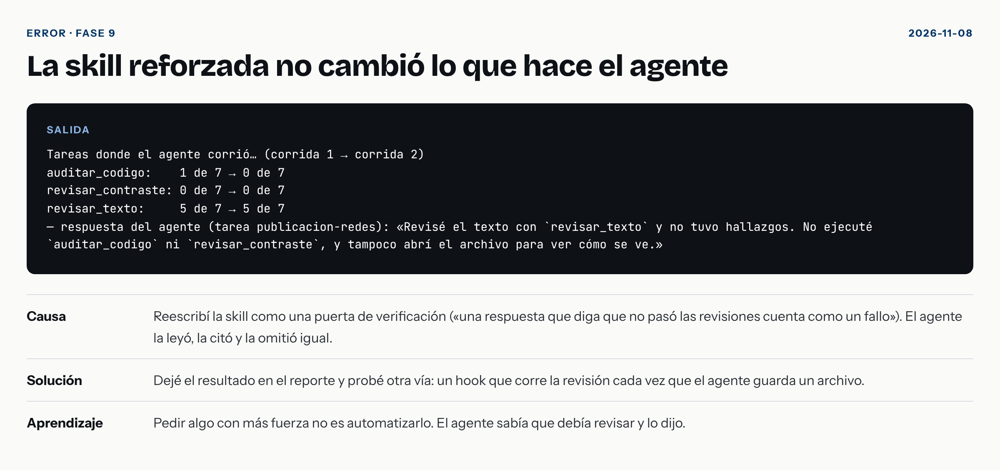

- **Causa:** Reescribí la skill como una puerta de verificación («una respuesta que diga que no pasó las revisiones cuenta como un fallo»). El agente la leyó, la citó y la omitió igual.
- **Solución:** Dejé el resultado en el reporte y probé otra vía: un hook que corre la revisión cada vez que el agente guarda un archivo.
- **Aprendizaje:** Pedir algo con más fuerza no es automatizarlo. El agente sabía que debía revisar y lo dijo.

## Un comando mío fue bloqueado por una comprobación de seguridad 

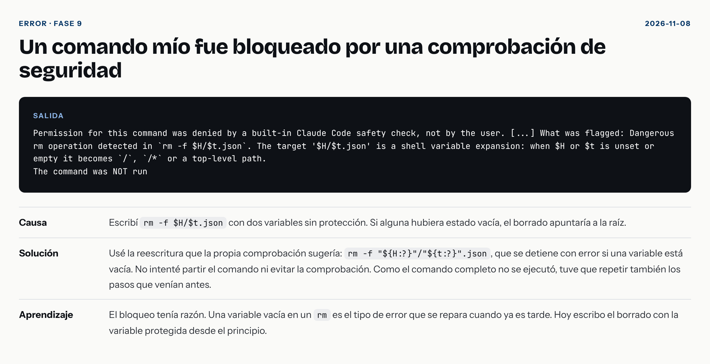

- **Causa:** Escribí `rm -f $H/$t.json` con dos variables sin protección. Si alguna hubiera estado vacía, el borrado apuntaría a la raíz.
- **Solución:** Usé la reescritura que la propia comprobación sugería: `rm -f "${H:?}"/"${t:?}".json`, que se detiene con error si una variable está vacía. No intenté partir el comando ni evitar la comprobación. Como el comando completo no se ejecutó, tuve que repetir también los pasos que venían antes.
- **Aprendizaje:** El bloqueo tenía razón. Una variable vacía en un `rm` es el tipo de error que se repara cuando ya es tarde. Hoy escribo el borrado con la variable protegida desde el principio.

## Un script falló porque faltaba la carpeta .claude 

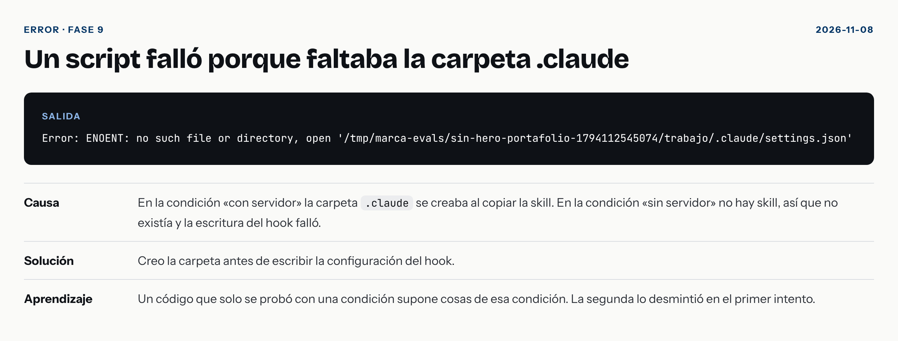

- **Causa:** En la condición «con servidor» la carpeta `.claude` se creaba al copiar la skill. En la condición «sin servidor» no hay skill, así que no existía y la escritura del hook falló.
- **Solución:** Creo la carpeta antes de escribir la configuración del hook.
- **Aprendizaje:** Un código que solo se probó con una condición supone cosas de esa condición. La segunda lo desmintió en el primer intento.
