# Calificación visual

Califique de **1 a 5** qué tanto se parece cada resultado a su marca (1 = nada, 5 = idéntico a lo que usted habría hecho).
Escriba solo el número en las columnas «Nota». Al correr `npm run evals` se promedian en `reporte.md`.

| Tarea | Sin servidor | Con servidor | Nota sin (1–5) | Nota con (1–5) | Comentarios |
|---|---|---|:---:|:---:|---|
| Hero para el portafolio (`hero-portafolio`) | 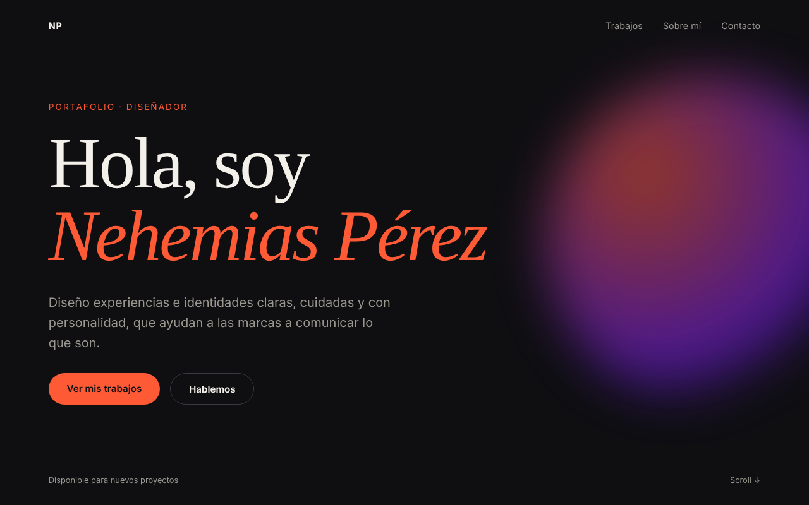 | 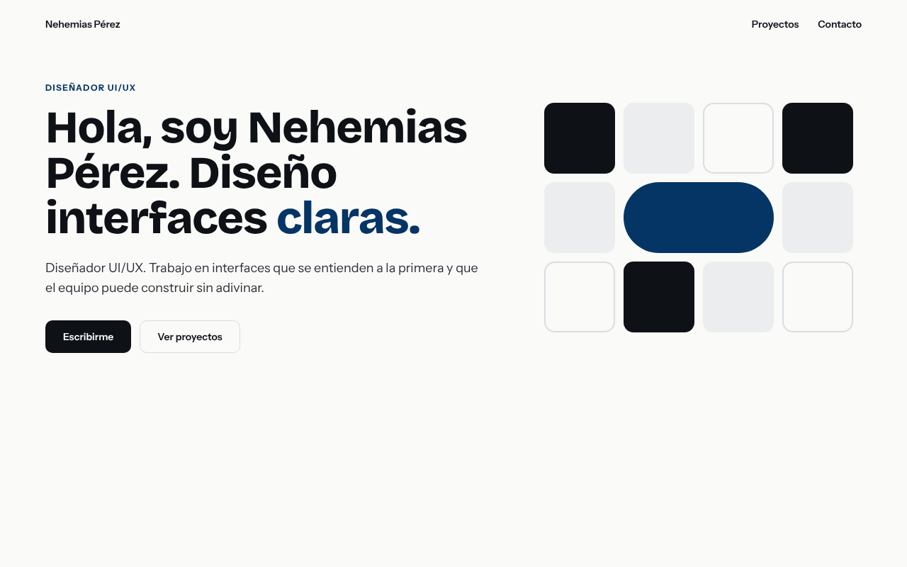 |  |  |  |
| Tarjeta de proyecto (`tarjeta-proyecto`) | 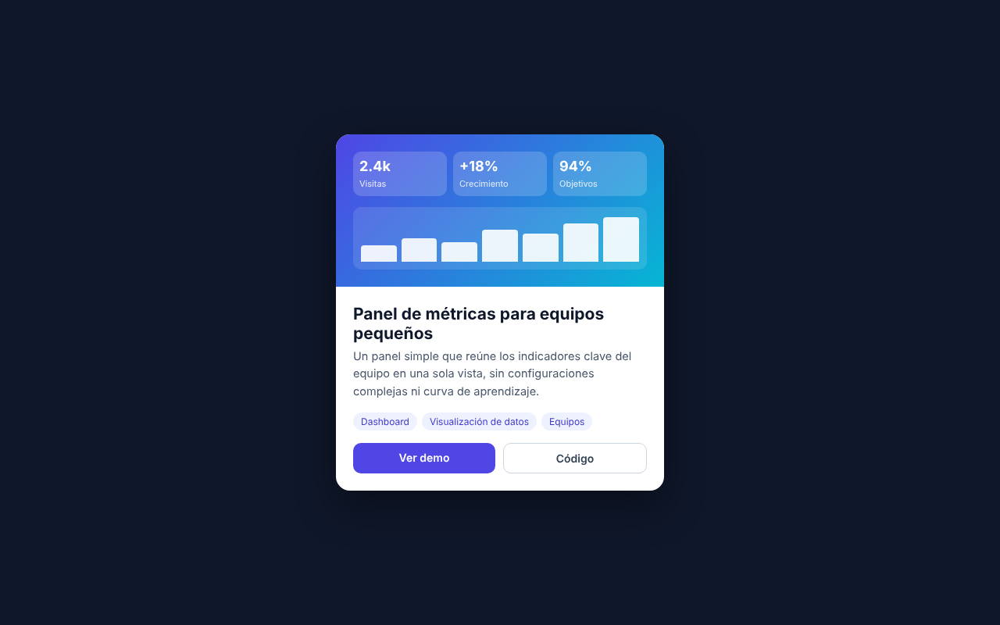 | 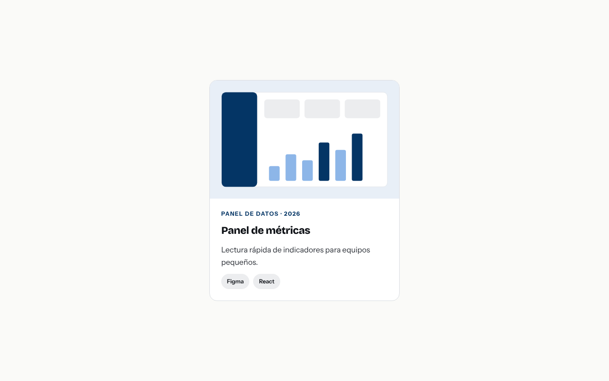 |  |  |  |
| Portada de propuesta (PDF) (`portada-propuesta`) | 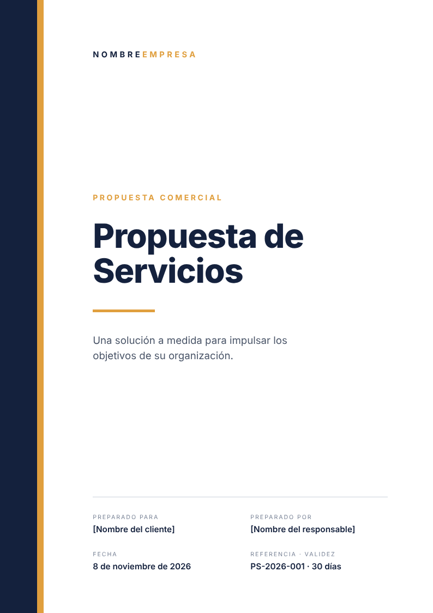 | 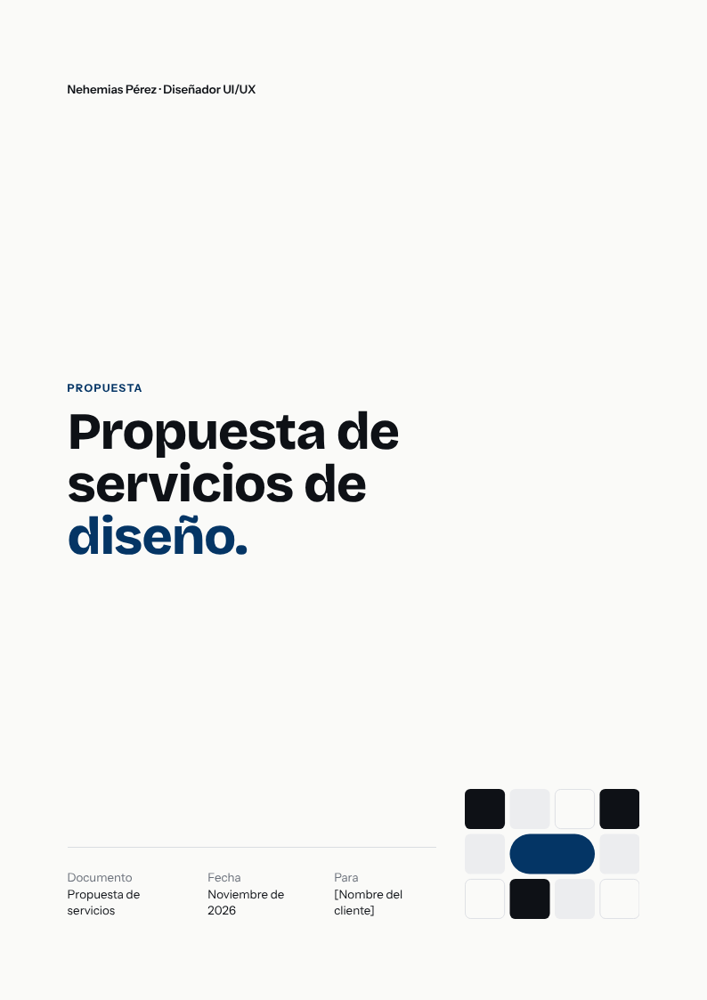 |  |  |  |
| Publicación para redes (`publicacion-redes`) | 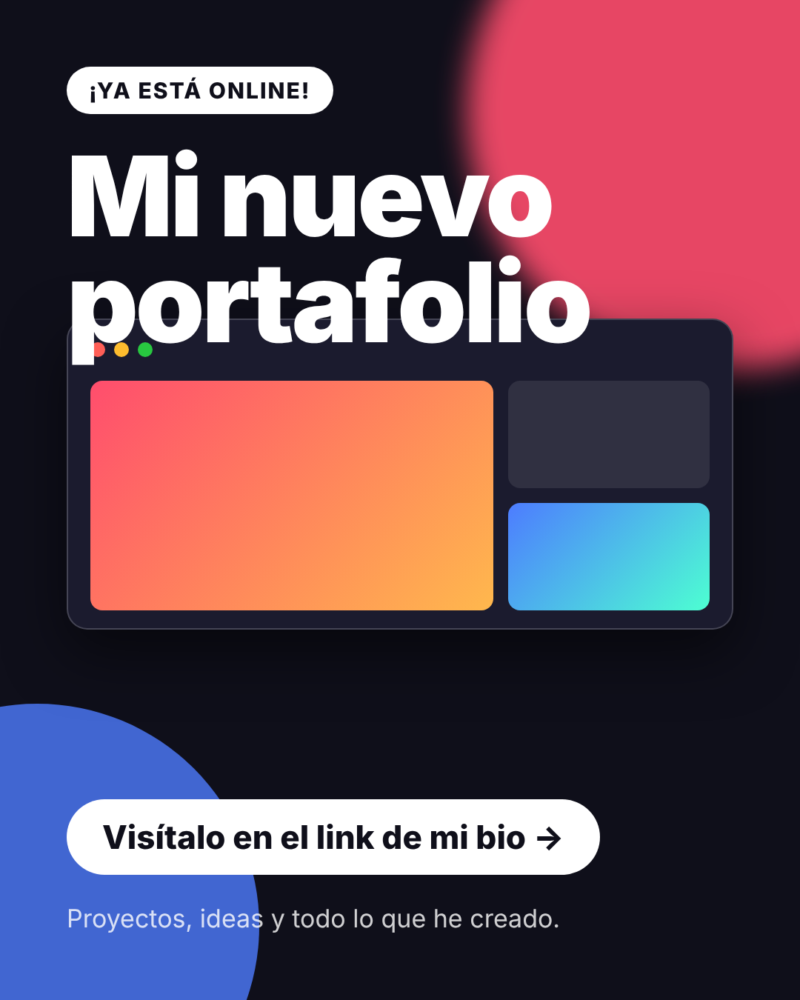 | 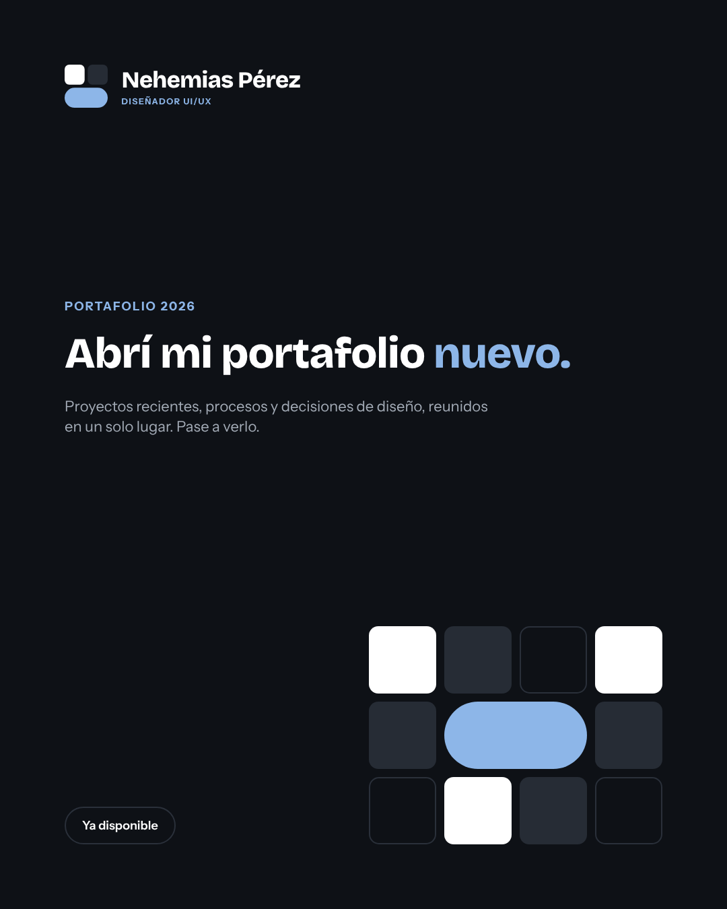 |  |  |  |
| Aviso destacado (`aviso-destacado`) | 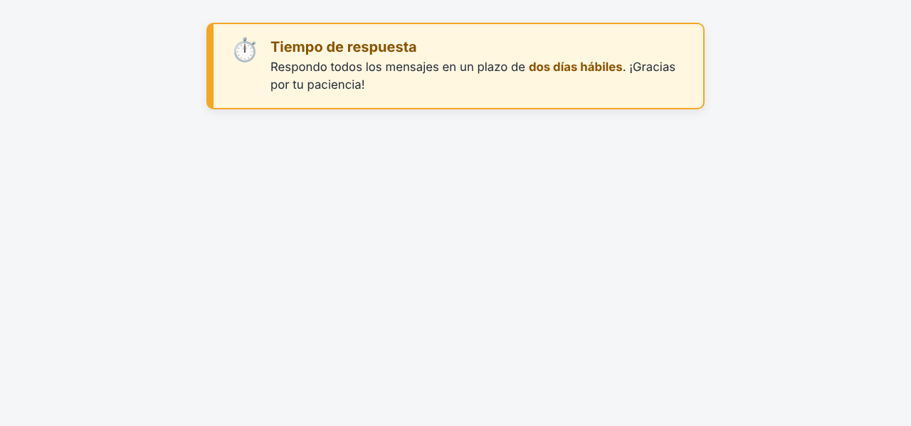 | 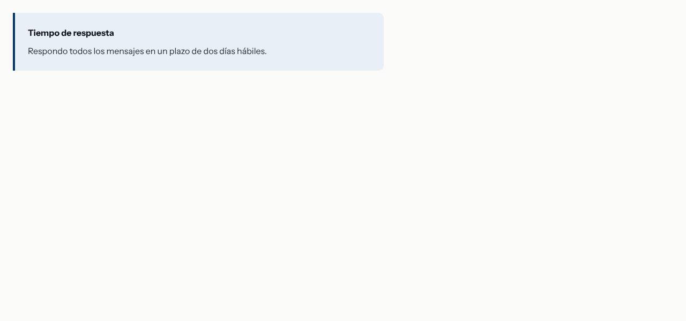 |  |  |  |
| Tabla de precios (`tabla-precios`) | 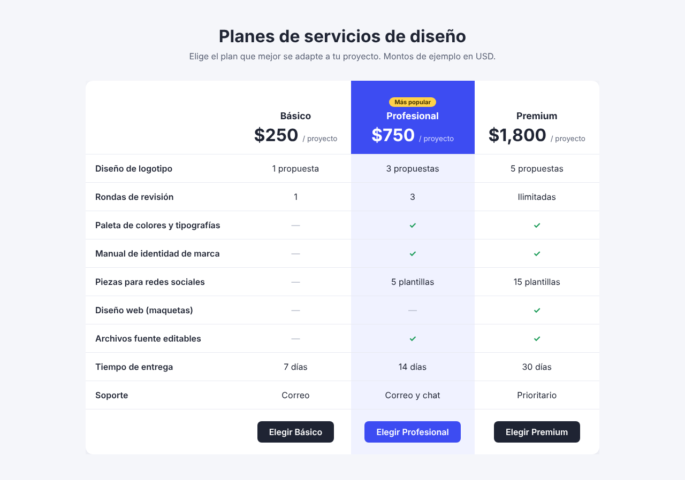 | 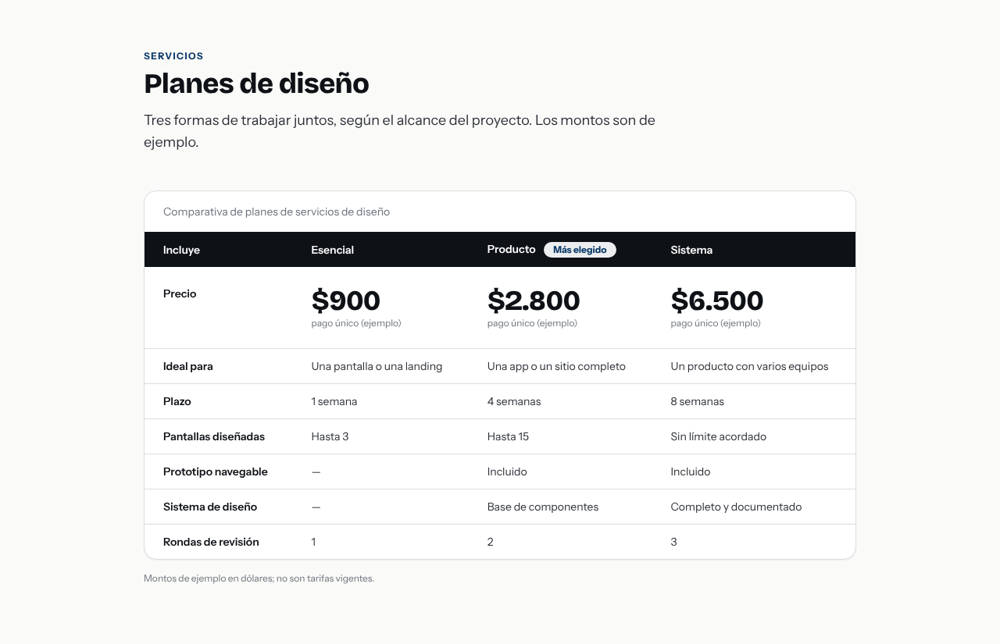 |  |  |  |
| Bloque de contacto con QR (`bloque-contacto`) | 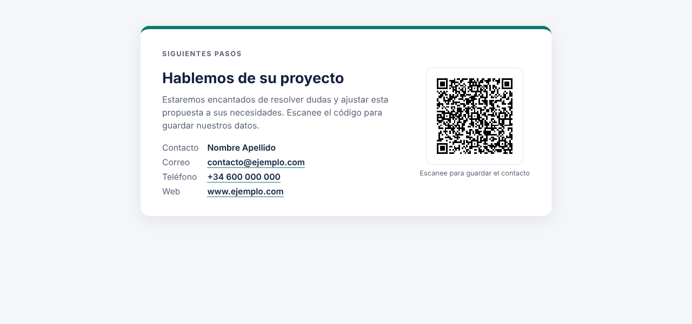 | 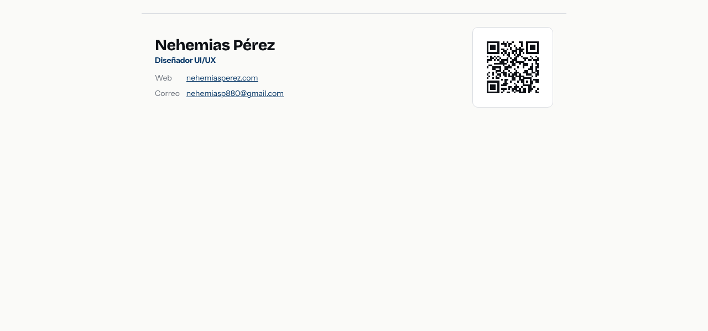 |  |  |  |
