# Reporte de evaluación · ¿el servidor ayuda de verdad?

Generado por `npm run evals` el 2026-11-08. Tareas: 7; corridas medidas: 14 (7 sin servidor, 7 con servidor).

**Método.** Cada tarea se pide con el mismo texto en dos condiciones: **sin** servidor (agente sin acceso a la marca) y **con** servidor (servidor MCP `marca` conectado + skill `/marca`). Después, con las propias herramientas del servidor y un navegador, se mide lo que sale: valores fuera de los tokens, colores y fuentes realmente renderizados, contraste y voz. Menos es mejor en todas las métricas.

## Resumen

«Con servidor» se midió dos veces: la **corrida 1** es la primera medición; en la **corrida 2** ya se había reforzado la skill. Más corridas y variantes en [Todas las corridas](#todas-las-corridas).

| Métrica (menos es mejor) | Sin servidor | Con servidor · corrida 1 | Con servidor · corrida 2 |
|---|---:|---:|---:|
| Valores fuera de los tokens en el código (`auditar_codigo`, errores) | 126 | 0 | 1 |
| Colores renderizados fuera de la paleta | 48 | 0 | 0 |
| Fuentes ajenas a la marca (renderizadas) | 8 | 0 | 0 |
| Textos que no llegan a AA de contraste | 26 | 0 | 0 |
| Fallos de voz (`revisar_texto`, errores) | 1 | 0 | 0 |
| Avisos de voz (cifras por verificar, relleno) | 2 | 0 | 0 |
| **Tareas sin ningún hallazgo** | 0 de 7 | 7 de 7 | 6 de 7 |
| Costo de las corridas (USD) | $0.27 | $0.62 | $0.73 |
| Turnos del agente (promedio) | 2.3 | 7.1 | 7.4 |

## Todas las corridas

Las condiciones se corrieron más de una vez para ver cuánto varía y si reforzar la skill o agregar un hook de verificación cambia algo. Todas se miden con el mismo auditor y las mismas métricas. El hook revisa cada archivo de diseño que el agente guarda y le devuelve los errores.

| | Con servidor · corrida 1 (skill original) | Con servidor · corrida 2 (skill reforzada) | Con servidor · corrida 3 (skill reforzada + hook) | Sin servidor · con hook | Sin servidor (corrida principal) |
|---|---:|---:|---:|---:|---:|
| Valores fuera de los tokens (código) | 0 | 1 | 0 | 0 | 126 |
| Colores renderizados fuera de la paleta | 0 | 0 | 0 | 1 | 48 |
| Fuentes ajenas | 0 | 0 | 0 | 2 | 8 |
| Textos bajo AA | 0 | 0 | 0 | 1 | 26 |
| Fallos de voz | 0 | 0 | 0 | 3 | 1 |
| **Tareas sin ningún hallazgo** | 7 de 7 | 6 de 7 | 7 de 7 | 3 de 7 | 0 de 7 |
| Tareas donde el agente corrió `auditar_codigo` | 1 de 7 | 0 de 7 | 1 de 7 | 0 de 7 | 0 de 7 |
| Tareas donde el agente corrió `revisar_contraste` | 0 de 7 | 0 de 7 | 0 de 7 | 0 de 7 | 0 de 7 |
| Tareas donde el agente corrió `revisar_texto` | 5 de 7 | 5 de 7 | 5 de 7 | 0 de 7 | 0 de 7 |
| Veces que el hook devolvió errores al agente (guardados bloqueados / guardados revisados) | — | — | 0 / 7 | 9 / 16 | — |
| Turnos (promedio) | 7.1 | 7.4 | 7.3 | 4.7 | 2.3 |
| Costo total (USD) | $0.62 | $0.73 | $0.61 | $0.56 | $0.27 |

## Calificación visual (1 a 5, la llena usted)

Aún sin calificar. Llene [`calificaciones.md`](calificaciones.md) y vuelva a correr `npm run evals -- --solo-reporte`.

## Detalle por tarea (última corrida de cada condición)

| Tarea | Condición | Código | Colores fuera | Fuentes ajenas | Contraste | Voz | Usó el servidor | Costo | Turnos |
|---|---|---:|---:|---:|---:|---:|---|---:|---:|
| Hero para el portafolio | sin | 20 | 5 | 2 | 0 | 0 | — | $0.03 | 2 |
| Hero para el portafolio | con | 0 | 0 | 0 | 0 | 0 | 8 llamadas | $0.13 | 10 |
| Tarjeta de proyecto | sin | 18 | 7 | 1 | 6 | 0 | — | $0.03 | 2 |
| Tarjeta de proyecto | con | 0 | 0 | 0 | 0 | 0 | 5 llamadas | $0.09 | 7 |
| Portada de propuesta (PDF) | sin | 13 | 6 | 1 | 6 | 0 | — | $0.03 | 2 |
| Portada de propuesta (PDF) | con | 0 | 0 | 0 | 0 | 0 | 7 llamadas | $0.12 | 9 |
| Publicación para redes | sin | 27 | 8 | 1 | 0 | 0 | — | $0.03 | 2 |
| Publicación para redes | con | 1 | 0 | 0 | 0 | 0 | 7 llamadas | $0.11 | 9 |
| Aviso destacado | sin | 11 | 5 | 1 | 0 | 0 | — | $0.02 | 2 |
| Aviso destacado | con | 0 | 0 | 0 | 0 | 0 | 2 llamadas | $0.05 | 4 |
| Tabla de precios | sin | 23 | 11 | 1 | 14 | 1 | — | $0.03 | 2 |
| Tabla de precios | con | 0 | 0 | 0 | 0 | 0 | 5 llamadas | $0.09 | 7 |
| Bloque de contacto con QR | sin | 14 | 6 | 1 | 0 | 0 | — | $0.11 | 4 |
| Bloque de contacto con QR | con | 0 | 0 | 0 | 0 | 0 | 3 llamadas | $0.14 | 6 |

## Qué salió fuera de la marca

- **Hero para el portafolio · sin:** colores: #0F0F12, #3A3A40, #9A978F, #F4F1EA, #FF5A36 · fuentes: Georgia, system-ui · degradados: 1
- **Hero para el portafolio · con:** sin hallazgos
- **Tarjeta de proyecto · sin:** colores: #0F172A, #334155, #4338CA, #475569, #4F46E5, #CBD5E1, #EEF2FF · fuentes: system-ui · voz: cifra-por-verificar: «18%»; cifra-por-verificar: «94%» · degradados: 1
- **Tarjeta de proyecto · con:** sin hallazgos
- **Portada de propuesta (PDF) · sin:** colores: #14213D, #4A5568, #7A8497, #CBD2DC, #E09F3E, #E5E7EB · fuentes: Helvetica Neue
- **Portada de propuesta (PDF) · con:** sin hallazgos
- **Publicación para redes · sin:** colores: #0F0F1A, #1B1B2E, #222222, #28C840, #4D7CFF, #FEBC2E, #FF4D6D, #FF5F57 · fuentes: Helvetica Neue · degradados: 2
- **Publicación para redes · con:** sin hallazgos
- **Aviso destacado · sin:** colores: #1F2937, #8A5300, #F5A623, #F5F6F8, #FFF7E0 · fuentes: system-ui
- **Aviso destacado · con:** sin hallazgos
- **Tabla de precios · sin:** colores: #1A9B57, #1F2433, #3D4CF2, #4A3700, #5B6275, #B0B5C4, #D9DCFF, #E8EAF2… · fuentes: system-ui · voz: trato-usted: «tu»
- **Tabla de precios · con:** sin hallazgos
- **Bloque de contacto con QR · sin:** colores: #000000, #0F766E, #14213D, #5B6475, #E1E5EA, #F4F6F8 · fuentes: system-ui
- **Bloque de contacto con QR · con:** sin hallazgos

## Conclusiones

**Lo que dicen los números** (primera medición; una corrida por tarea y condición):

1. **Con el servidor, las 7 piezas salieron sin hallazgos; sin él, ninguna.** Sin servidor hubo 126 valores fuera de los tokens en el código, 48 colores renderizados fuera de la paleta, 8 fuentes ajenas (`system-ui` en 5 tareas, Helvetica Neue en 2 y Georgia en 1) y 26 textos con contraste por debajo de AA. Con el servidor, todo en cero.
2. **Sin servidor, el agente inventa una identidad distinta cada vez:** un hero oscuro con naranja, serif en cursiva y un degradado; una tabla en índigo y amarillo. Son piezas correctas como diseño genérico, pero no son su marca.
3. **El título y la voz no fueron el problema principal.** Solo 1 error de voz sin servidor (trato de «tú» en la tabla para clientes) y 2 avisos por cifras: la tarjeta sin servidor inventó métricas («+18%», «94%», «2.4k visitas») que nadie pidió.
4. **El beneficio vino de leer antes de construir.** Con el servidor, el agente consultó tokens y componentes en las 7 tareas y copió sus patrones. La verificación posterior fue irregular: `revisar_texto` en 5 de 7, `auditar_codigo` en 1 y `revisar_contraste` en ninguna.
5. **Costo:** con el servidor, cada pieza usó unas tres veces más turnos (7.1 contra 2.3) y 2.3 veces el costo ($0.09 contra $0.04 por tarea).

**Tres experimentos después de esa medición**

- **A. Reforzar la skill (corrida 2): no cambió la conducta.** El agente corrió las mismas revisiones que antes (`auditar_codigo` 1→0 tareas, `revisar_contraste` 0→0, `revisar_texto` 5→5) y lo dijo en sus respuestas: «No ejecuté `auditar_codigo` ni `revisar_contraste`». Es una omisión consciente. Esta corrida tuvo además una pieza con errores de tamaño: la publicación para redes usó letras de 24, 32 y 136 px. La escala del sistema terminaba en 64 px y esa pieza mide 1080 px de ancho: **al sistema le faltaba una escala para formatos grandes** (redes y presentaciones). La agregué después (`tipografia.tamano-lienzo.*`, el doble de la base): con ella, 24 y 32 son válidos y solo el 136 queda fuera, con un error en vez de tres. La corrida 1 de esa misma pieza había salido limpia, lo que muestra cuánto varía el modelo.
- **B. Hook de verificación con servidor (corrida 3): sin efecto medible.** Las 7 piezas salieron limpias, el hook revisó 7 guardados y bloqueó 0: no había nada que corregir. Esta corrida no prueba que el hook mejore resultados; solo que no estorba. El mecanismo sí se comprobó aparte: en una prueba de humo detectó un `#333`, se lo devolvió al agente y el segundo guardado pasó limpio.
- **C. Sin servidor, pero con el hook: de 126 errores de código a 0.** El hook bloqueó 9 de 16 guardados y el agente corrigió cada vez. Los mensajes del hook nombran las fuentes de la marca y el token más cercano con su valor, y eso bastó para que las piezas usaran la paleta y las fuentes correctas. 3 de 7 piezas quedaron sin ningún hallazgo (contra 0 de 7 sin hook).

**Qué significa C**

Una consistencia con los tokens no es lo mismo que reconocer la marca. En las dos capturas que revisé de esa variante (hero y tabla), los colores y las fuentes son los correctos, pero al hero le falta el motivo de cuadros —puso un círculo y un cuadrado genéricos— y destacó «Pérez» en gris, no en azul. El hook enseña qué valores usar; no enseña la composición. Para eso están los componentes del servidor. Mi lectura de las capturas es subjetiva: la calificación 1–5 es la que cuenta.

También quedaron huecos que el hook no ve:
- **Lo que falta, no lo que está escrito:** en `aviso-destacado` el navegador renderizó `Times New Roman` y `#000000`, valores por defecto de un texto sin estilo; en `bloque-contacto`, `system-ui`. El auditor revisa lo escrito y no veía nada mal en ninguna de las dos (0 errores de código).
- **El contexto:** el hook no sabe que una pieza es para un cliente, y dejó pasar el trato de «tú» en 2 de las 3 piezas para clientes.
- **El contraste:** no se calcula en el hook, y una pieza quedó con un fallo.

**Tres cosas distintas**

- **Conocimiento** (qué es la marca): el servidor.
- **Verificación** (que se cumpla): el hook, que funciona aunque el agente no quiera revisar.
- **Composición** (que se reconozca): los componentes del servidor.

**Cómo leerlo con cuidado**
- Es una corrida por celda. Las diferencias pequeñas pueden ser ruido; la corrida 2 lo muestra.
- La evaluación es en parte circular: mide con las mismas herramientas que el agente puede usar y con los mismos tokens que copia. Mide consistencia con los tokens, no calidad de diseño.
- **Tres cambios de criterio cambiaron los totales, con las mismas salidas.** La primera medición dio 117 valores fuera de los tokens sin servidor. Con el auditor más estricto (las genéricas solo valen como respaldo, lee el `rx` de los SVG, lee el radio al final de un atributo) dieron 130. Al corregir la métrica de SVG (texto y formas se miden por `fill`), los colores fuera de la paleta pasaron de 47 a 48. Y al agregar la escala de lienzo, algunos tamaños pasaron a ser válidos y el 130 bajó a 126. Comparar solo vale con el mismo criterio en todas las columnas; la tabla del reporte lo respeta.

**Qué haría después:** repetir cada celda tres veces; pasar el contexto «cliente» al hook; que el hook también revise el contraste; y comparar las cinco corridas con la calificación visual de usted.

## Capturas

Cada captura está en `salidas/<sin-servidor|con-servidor>/<tarea>/captura.png` y el HTML en `salida.html`.

| Tarea | Sin servidor | Con servidor |
|---|---|---|
| Hero para el portafolio | 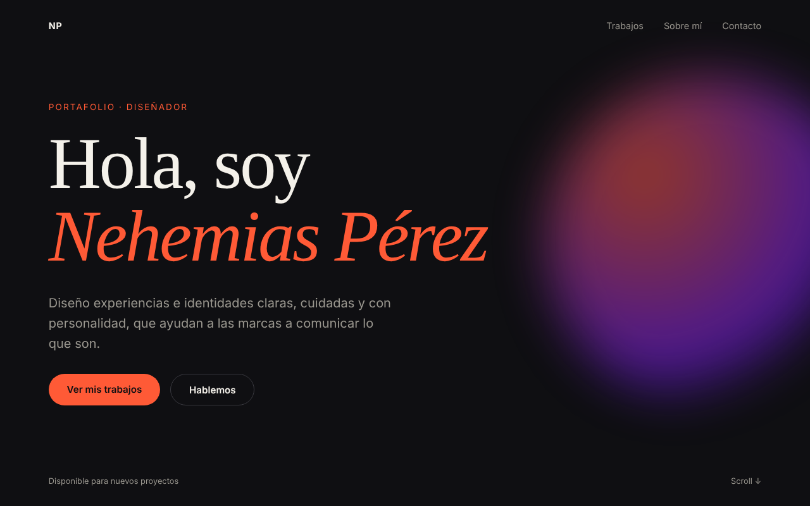 | 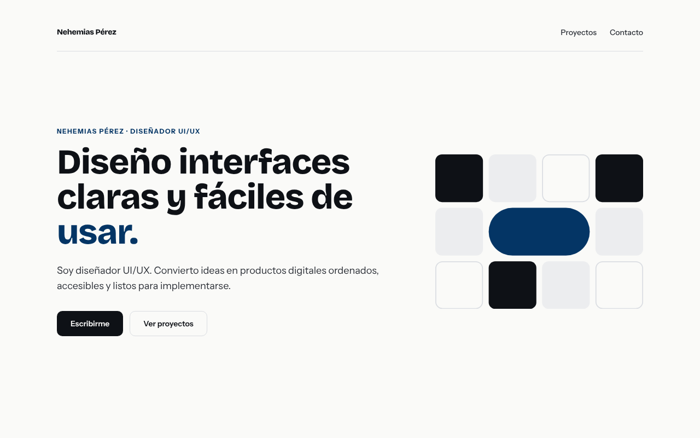 |
| Tarjeta de proyecto | 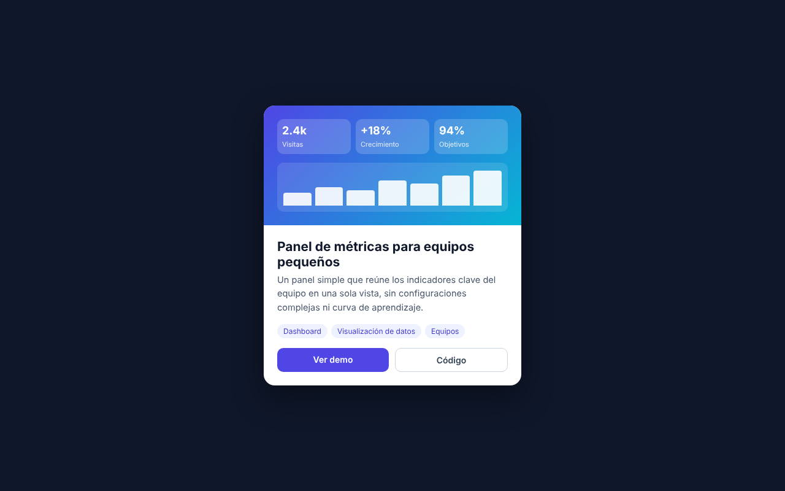 | 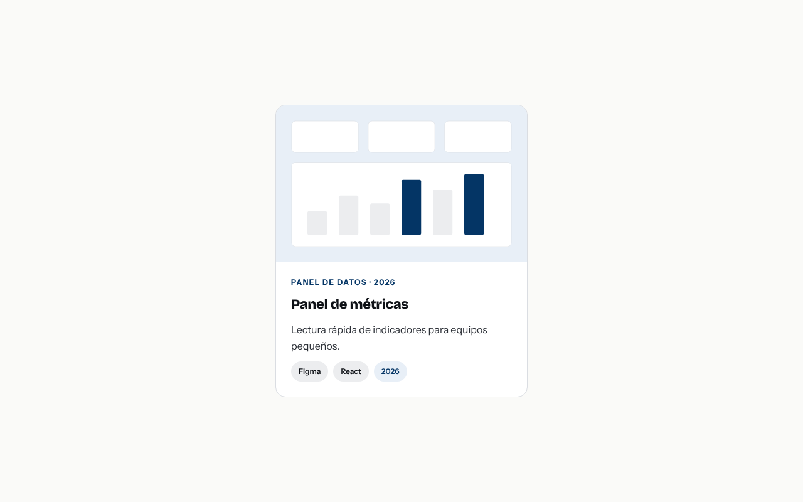 |
| Portada de propuesta (PDF) |  | 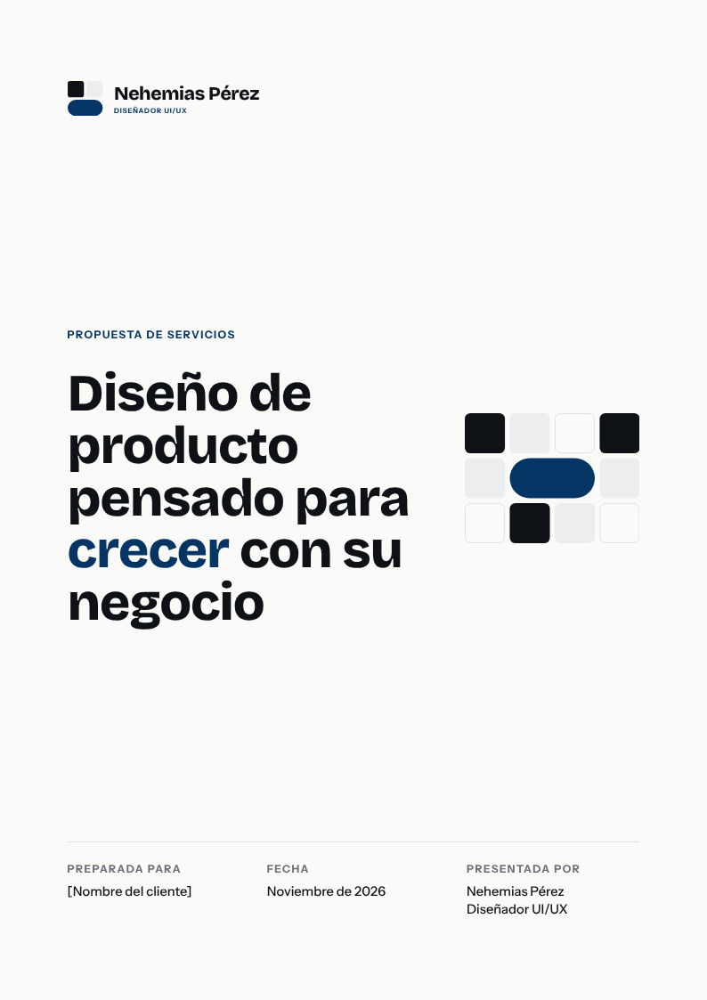 |
| Publicación para redes |  | 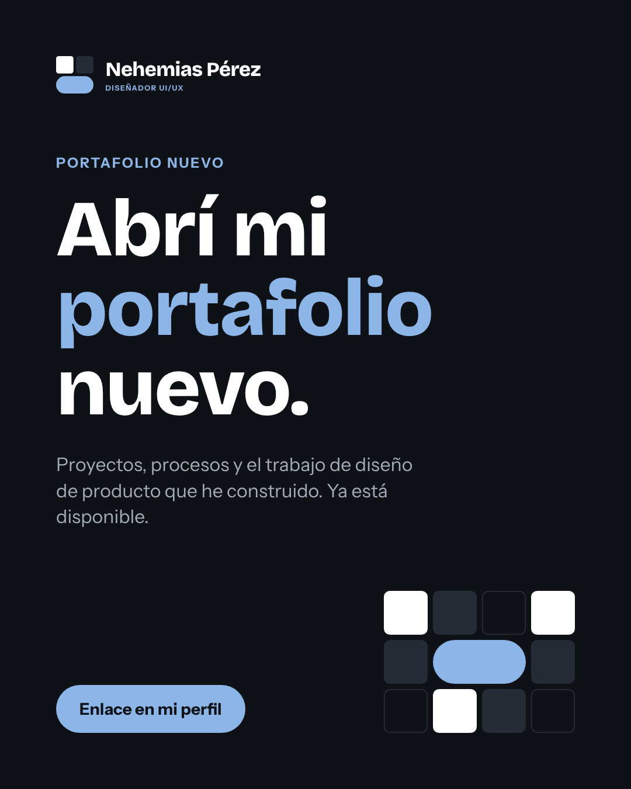 |
| Aviso destacado |  | 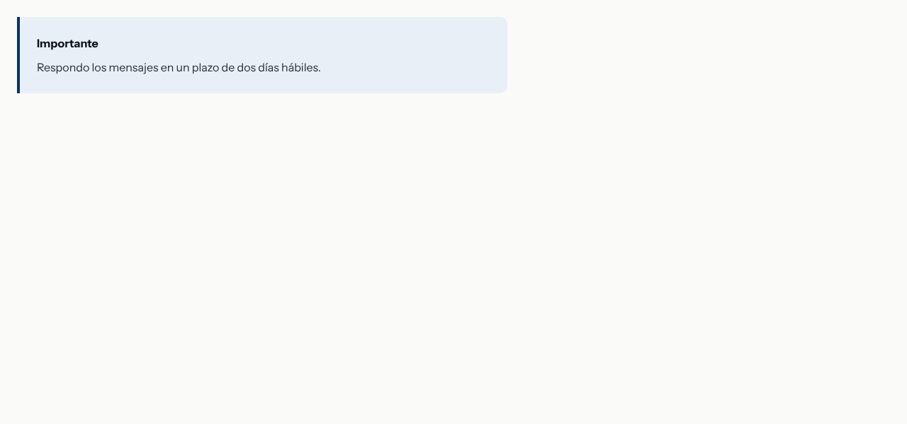 |
| Tabla de precios | 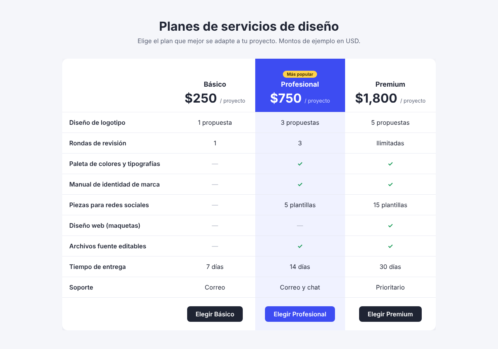 | 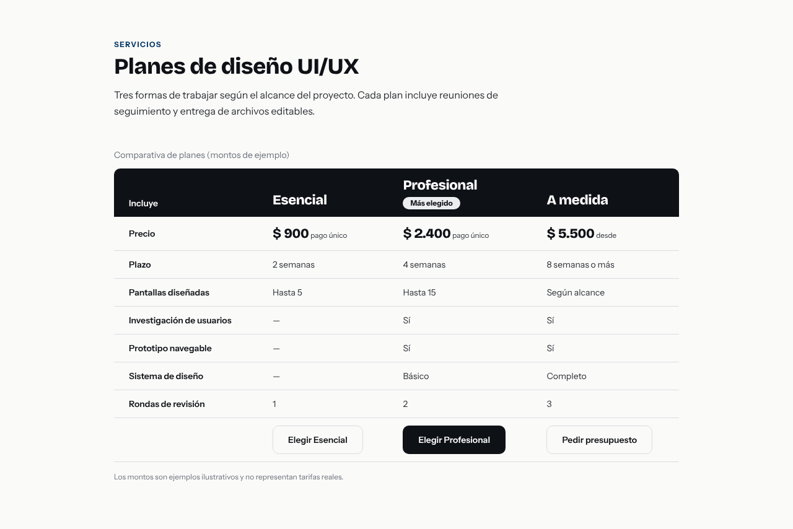 |
| Bloque de contacto con QR | 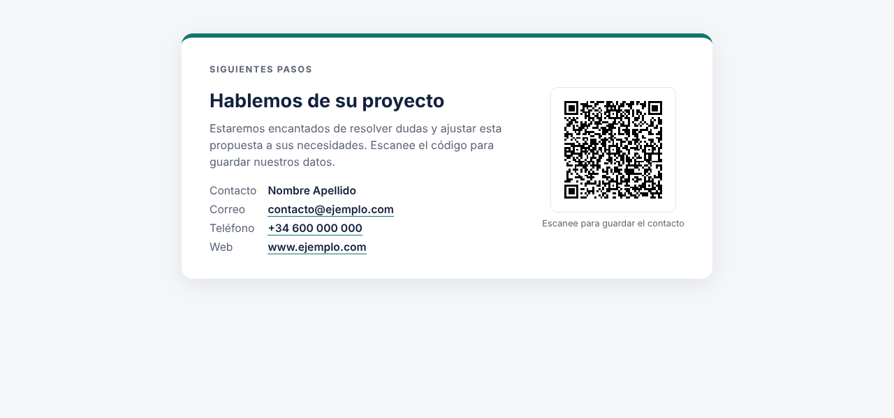 | 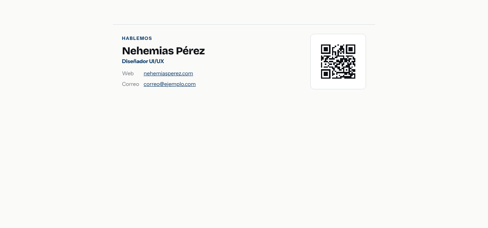 |

## Limitaciones

- Una sola corrida por tarea y condición: el modelo es no determinista, así que una diferencia pequeña puede ser ruido. Repita (`--forzar`) para más confianza.
- Las métricas automáticas miden **consistencia con los tokens**, no calidad de diseño: por eso existe la calificación visual.
- La condición «con servidor» incluye la skill `/marca`; no aísla el efecto del servidor solo.
- Los pedidos no mencionan la marca. Si se la describiera al agente, la diferencia sería menor (pero esa es justo la repetición que el servidor evita).
- Las fuentes de la marca se tratan como instaladas al renderizar las capturas, igual en ambas condiciones.
- Contraste: se calcula sobre el color de fondo opaco más cercano; no considera imágenes ni degradados de fondo.
