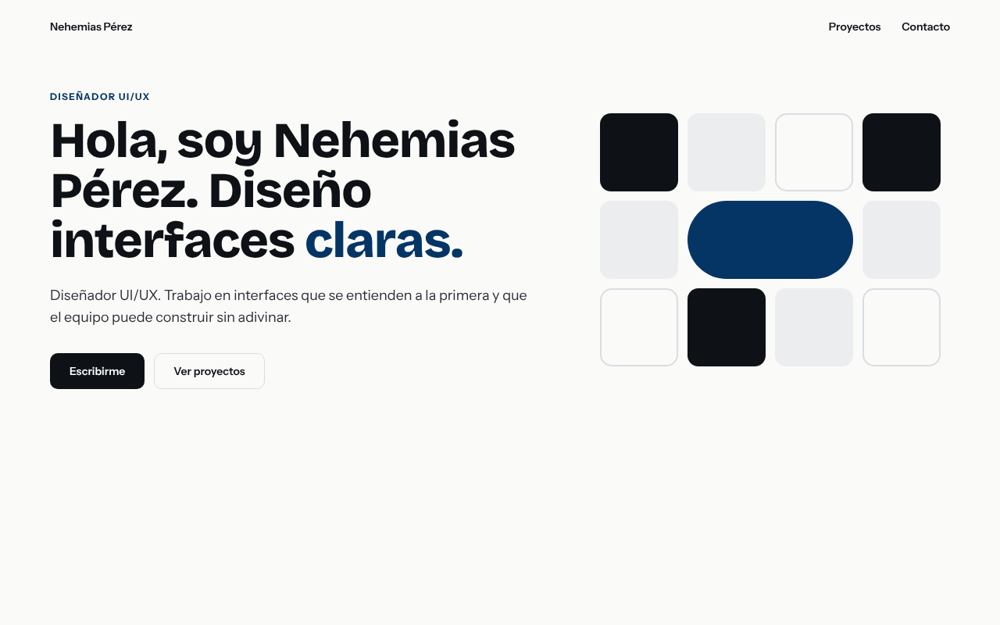
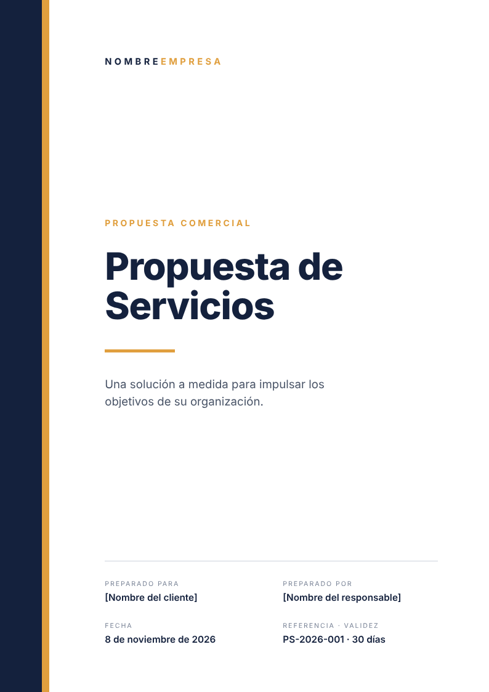
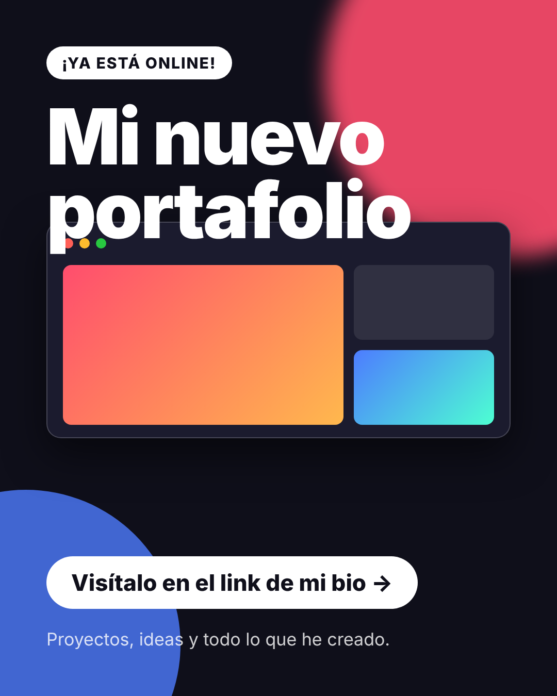
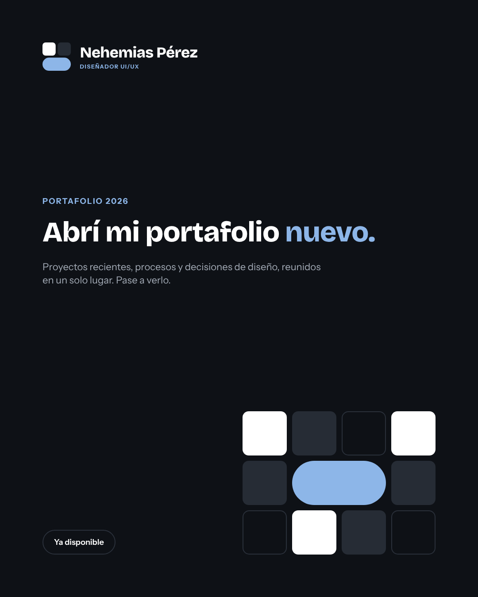
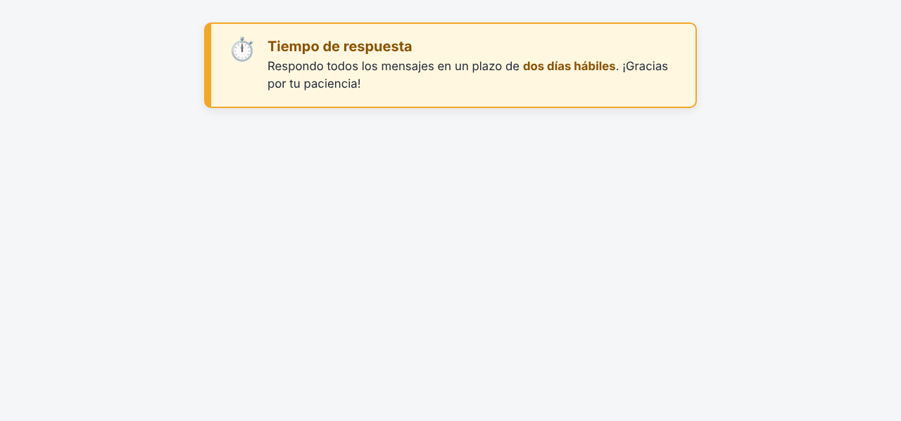
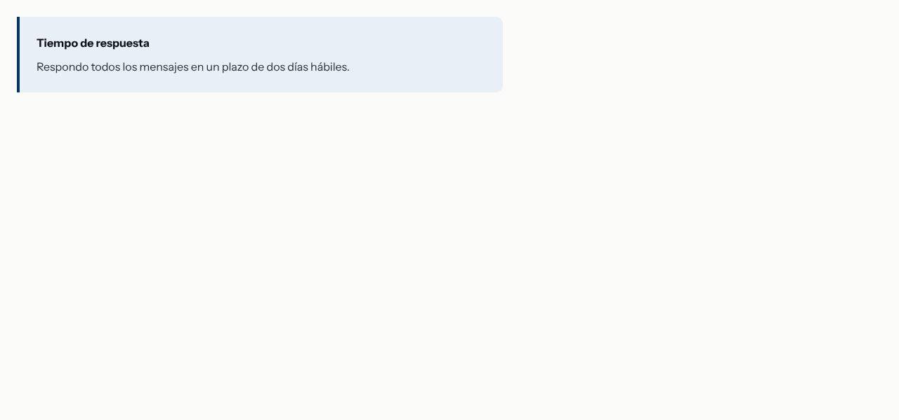
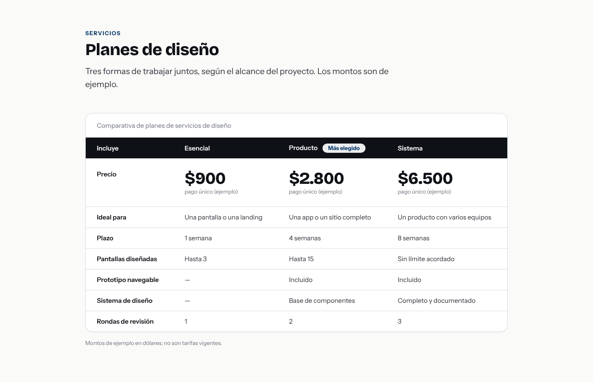

# Reporte de evaluación · ¿el servidor ayuda de verdad?

Generado por `npm run evals` el 2026-11-08. Tareas: 7; corridas medidas: 14 (7 sin servidor, 7 con servidor).

**Método.** Cada tarea se pide con el mismo texto en dos condiciones: **sin** servidor (agente sin acceso a la marca) y **con** servidor (servidor MCP `marca` conectado + skill `/marca`). Después, con las propias herramientas del servidor y un navegador, se mide lo que sale: valores fuera de los tokens, colores y fuentes realmente renderizados, contraste y voz. Menos es mejor en todas las métricas.

## Resumen

| Métrica (menos es mejor) | Sin servidor (total) | Con servidor (total) | Sin (promedio por tarea) | Con (promedio por tarea) |
|---|---:|---:|---:|---:|
| Valores fuera de los tokens en el código (`auditar_codigo`, errores) | 117 | 0 | 16.7 | 0 |
| Colores renderizados fuera de la paleta | 47 | 0 | 6.7 | 0 |
| Fuentes ajenas a la marca (renderizadas) | 8 | 0 | 1.1 | 0 |
| Textos que no llegan a AA de contraste | 26 | 0 | 3.7 | 0 |
| Fallos de voz (`revisar_texto`, errores) | 1 | 0 | 0.1 | 0 |
| Avisos de voz (cifras por verificar, relleno) | 2 | 0 | 0.3 | 0 |
| **Tareas sin ningún hallazgo** | 0 de 7 | 7 de 7 | | |
| Costo de las corridas (USD) | $0.27 | $0.62 | $0.04 | $0.09 |
| Turnos del agente (promedio) | 2.3 | 7.1 | | |

## Calificación visual (1 a 5, la llena usted)

Aún sin calificar. Llene [`calificaciones.md`](calificaciones.md) y vuelva a correr `npm run evals -- --solo-reporte`.

## Detalle por tarea

| Tarea | Condición | Código | Colores fuera | Fuentes ajenas | Contraste | Voz | Usó el servidor | Costo | Turnos |
|---|---|---:|---:|---:|---:|---:|---|---:|---:|
| Hero para el portafolio | sin | 14 | 5 | 2 | 0 | 0 | — | $0.03 | 2 |
| Hero para el portafolio | con | 0 | 0 | 0 | 0 | 0 | 7 llamadas | $0.10 | 9 |
| Tarjeta de proyecto | sin | 18 | 7 | 1 | 6 | 0 | — | $0.03 | 2 |
| Tarjeta de proyecto | con | 0 | 0 | 0 | 0 | 0 | 6 llamadas | $0.08 | 8 |
| Portada de propuesta (PDF) | sin | 11 | 6 | 1 | 6 | 0 | — | $0.03 | 2 |
| Portada de propuesta (PDF) | con | 0 | 0 | 0 | 0 | 0 | 6 llamadas | $0.08 | 8 |
| Publicación para redes | sin | 26 | 8 | 1 | 0 | 0 | — | $0.03 | 2 |
| Publicación para redes | con | 0 | 0 | 0 | 0 | 0 | 7 llamadas | $0.09 | 9 |
| Aviso destacado | sin | 11 | 5 | 1 | 0 | 0 | — | $0.02 | 2 |
| Aviso destacado | con | 0 | 0 | 0 | 0 | 0 | 2 llamadas | $0.07 | 4 |
| Tabla de precios | sin | 24 | 11 | 1 | 14 | 1 | — | $0.03 | 2 |
| Tabla de precios | con | 0 | 0 | 0 | 0 | 0 | 4 llamadas | $0.08 | 6 |
| Bloque de contacto con QR | sin | 13 | 5 | 1 | 0 | 0 | — | $0.11 | 4 |
| Bloque de contacto con QR | con | 0 | 0 | 0 | 0 | 0 | 3 llamadas | $0.11 | 6 |

## Qué salió fuera de la marca

- **Hero para el portafolio · sin:** colores: #0F0F12, #3A3A40, #9A978F, #F4F1EA, #FF5A36 · fuentes: Georgia, system-ui · degradados: 1
- **Hero para el portafolio · con:** sin hallazgos
- **Tarjeta de proyecto · sin:** colores: #0F172A, #334155, #4338CA, #475569, #4F46E5, #CBD5E1, #EEF2FF · fuentes: system-ui · voz: cifra-por-verificar: «18%»; cifra-por-verificar: «94%» · degradados: 1
- **Tarjeta de proyecto · con:** sin hallazgos
- **Portada de propuesta (PDF) · sin:** colores: #14213D, #4A5568, #7A8497, #CBD2DC, #E09F3E, #E5E7EB · fuentes: Helvetica Neue
- **Portada de propuesta (PDF) · con:** sin hallazgos
- **Publicación para redes · sin:** colores: #0F0F1A, #1B1B2E, #222222, #28C840, #4D7CFF, #FEBC2E, #FF4D6D, #FF5F57 · fuentes: Helvetica Neue · degradados: 2
- **Publicación para redes · con:** sin hallazgos
- **Aviso destacado · sin:** colores: #1F2937, #8A5300, #F5A623, #F5F6F8, #FFF7E0 · fuentes: system-ui
- **Aviso destacado · con:** sin hallazgos
- **Tabla de precios · sin:** colores: #1A9B57, #1F2433, #3D4CF2, #4A3700, #5B6275, #B0B5C4, #D9DCFF, #E8EAF2… · fuentes: system-ui · voz: trato-usted: «tu»
- **Tabla de precios · con:** sin hallazgos
- **Bloque de contacto con QR · sin:** colores: #0F766E, #14213D, #5B6475, #E1E5EA, #F4F6F8 · fuentes: system-ui
- **Bloque de contacto con QR · con:** sin hallazgos

## Conclusiones

**Lo que dicen los números** (una corrida por tarea y condición; ver limitaciones):

1. **Con el servidor, las 7 piezas salieron sin hallazgos**; sin él, ninguna. Sin servidor hubo 117 valores fuera de los tokens en el código, 47 colores renderizados fuera de la paleta, 8 fuentes ajenas (system-ui en 5 tareas, Helvetica Neue en 2 y Georgia en 1) y 26 textos con contraste por debajo de AA. Con el servidor, todo en cero.
2. **Sin servidor, el agente inventa una identidad distinta cada vez**: un hero oscuro con naranja, serif en cursiva y un degradado; una tabla con azul índigo y amarillo. Son piezas correctas como diseño genérico, pero no son su marca: el acento, las fuentes y el motivo no aparecen en ninguna.
3. **El título y la voz no fueron el problema principal.** Solo 1 error de voz sin servidor (trato de «tú» en la tabla para clientes) y 2 avisos por cifras: la tarjeta sin servidor inventó métricas («+18%», «94%», «2.4k visitas») que nadie pidió. El agente sin servidor escribió «diseñador» a secas porque el pedido lo decía; la regla del título importará más cuando el pedido no lo mencione.
4. **El beneficio viene del paso «antes»**, no del «después». Con el servidor, el agente leyó tokens y componentes en las 7 tareas (`obtener_tokens`, `buscar_componente`, `obtener_componente`) y copió sus patrones. En cambio, la verificación posterior fue irregular: `revisar_texto` en 5 de 7, `auditar_codigo` en 1 de 7 y `revisar_contraste` en ninguna, aunque la skill la pide como obligatoria. Aun así quedó en cero porque los componentes ya salen limpios.
5. **Costo:** con el servidor, cada pieza usó ~3 veces más turnos (7.1 contra 2.3) y ~2.3 veces el costo ($0.09 contra $0.04 por tarea). Es barato, pero no es gratis.

**Cómo leerlo con cuidado**
- Es una evaluación **parcialmente circular**: se mide con las mismas herramientas que el agente puede usar y con los mismos tokens que copia. Mide *fidelidad a los tokens*, no que el diseño sea bueno; para eso está la calificación 1–5 de sus ojos.
- Es la **mejor corrida posible de la condición «con»** porque los componentes del servidor ya están auditados con el mismo auditor (hay una prueba que lo exige). Una marca documentada peor daría un resultado peor.

**Qué haría después:** repetir cada tarea 3 veces para ver la variación; probar «solo servidor, sin skill» para aislar su efecto; y que el agente use la verificación posterior de forma fiable (por ejemplo, con un hook que corra `auditar_codigo` al terminar).

## Capturas

Cada captura está en `salidas/<condición>/<tarea>/captura.png` y el HTML en `salida.html`.

| Tarea | Sin servidor | Con servidor |
|---|---|---|
| Hero para el portafolio |  |  |
| Tarjeta de proyecto |  |  |
| Portada de propuesta (PDF) |  |  |
| Publicación para redes |  |  |
| Aviso destacado |  |  |
| Tabla de precios |  |  |
| Bloque de contacto con QR |  |  |

## Limitaciones

- Una sola corrida por tarea y condición: el modelo es no determinista, así que una diferencia pequeña puede ser ruido. Repita (`--forzar`) para más confianza.
- Las métricas automáticas miden **consistencia con los tokens**, no calidad de diseño: por eso existe la calificación visual.
- La condición «con servidor» incluye la skill `/marca`; no aísla el efecto del servidor solo.
- Los pedidos no mencionan la marca. Si se la describiera al agente, la diferencia sería menor (pero esa es justo la repetición que el servidor evita).
- Las fuentes de la marca se tratan como instaladas al renderizar las capturas, igual en ambas condiciones.
- Contraste: se calcula sobre el color de fondo opaco más cercano; no considera imágenes ni degradados de fondo.
