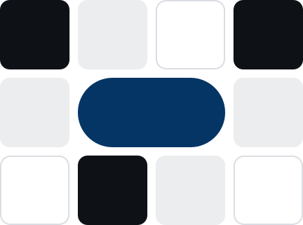

# Motivo de cuadros

## Para qué sirve
Es la firma visual: una **rejilla de 4 columnas × 3 filas** de cuadros redondeados (`radio.cuadro`) en tres tratamientos —**tinta**, **suave** y **vacío** (solo contorno)— más **una píldora azul que ocupa dos columnas**. Existe una **versión mini de 2 × 2** con la píldora abajo. Se usa en portadas, tarjetas de presentación, cierres y como sello.

## Cuándo no usarlo
- **Nunca detrás de texto largo** (ver `reglas`): compite con la lectura.
- Más de un motivo completo por pantalla o página.
- Recolorearlo con colores fuera de la paleta o con degradados.
- Deformarlo: respete la proporción; el hueco entre cuadros es el 12% del lado.
- La versión completa por debajo de 120px de ancho: use la mini.

## Variantes y estados
| Variante | Cuadros | Vacíos | Píldora |
|---|---|---|---|
| Completo claro | `color.tinta` y `color.suave` | contorno `color.linea` | `color.azul` |
| Completo oscuro | `color.blanco` y `color.oscuro.cuadro` | contorno `color.oscuro.linea` | `color.oscuro.acento` |
| Mini claro / oscuro | igual que el completo, 2 × 2 con la píldora en la fila inferior | — | igual |

Archivos: `motivo-claro.svg`, `motivo-oscuro.svg`, `motivo-mini-claro.svg`, `motivo-mini-oscuro.svg` (herramienta `obtener_asset`, recurso `marca://assets/{nombre}`). Es estático; no tiene estados.

## Tokens que usa
`color.tinta`, `color.suave`, `color.azul`, `color.linea`, `radio.cuadro`, `radio.pill`; en oscuro: `color.blanco`, `color.oscuro.cuadro`, `color.oscuro.acento`, `color.oscuro.linea`.

## Accesibilidad
- Es decorativo: use `alt=""` o `aria-hidden="true"`; si funciona como logo, `role="img"` y un nombre.
- No comunique información solo con el motivo.
- Respete `prefers-reduced-motion` si lo anima (la marca no exige animación).

## Ejemplos de código

### HTML + CSS
```html
<!-- Opción simple: el SVG de assets -->


<!-- Opción en CSS (mini 2×2, claro) -->
<div class="motivo-mini" aria-hidden="true">
  <i class="motivo-mini__c motivo-mini__c--tinta"></i>
  <i class="motivo-mini__c motivo-mini__c--suave"></i>
  <i class="motivo-mini__pildora"></i>
</div>

<style>
  .motivo-mini { --lado: 26px; --hueco: 4px; display: grid; grid-template-columns: repeat(2, var(--lado)); gap: var(--hueco); }
  .motivo-mini__c { display: block; width: var(--lado); height: var(--lado); border-radius: 5px; }
  .motivo-mini__c--tinta { background: var(--color-tinta); }
  .motivo-mini__c--suave { background: var(--color-suave); }
  .motivo-mini__pildora { grid-column: 1 / -1; height: var(--lado); border-radius: var(--radius-pill); background: var(--color-azul); }
</style>
```

### React + Tailwind v4
```tsx
export function MotivoMini({ oscuro = false }: { oscuro?: boolean }) {
  return (
    <div aria-hidden="true" className="grid grid-cols-[repeat(2,1.625rem)] gap-1">
      <i className={`block size-[1.625rem] rounded-[5px] ${oscuro ? 'bg-blanco' : 'bg-tinta'}`} />
      <i className={`block size-[1.625rem] rounded-[5px] ${oscuro ? 'bg-oscuro-cuadro' : 'bg-suave'}`} />
      <i className={`col-span-2 h-[1.625rem] rounded-pill ${oscuro ? 'bg-oscuro-acento' : 'bg-azul'}`} />
    </div>
  );
}
```
Para el motivo completo (4×3) importe el SVG de `marca/assets/` como imagen o componente.

### Impresión (PDF)
```css
@media print {
  .motivo, .motivo-mini { -webkit-print-color-adjust: exact; print-color-adjust: exact; break-inside: avoid; }
  img[src$="motivo-claro.svg"] { width: 4cm; height: auto; }
}
```
