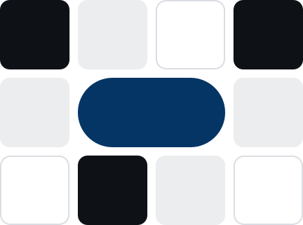

# Portada de documento

## Para qué sirve
Primera página de una propuesta, informe, CV o presentación. Composición fija en tres zonas: **nombre arriba** (marca personal), **título grande** al centro-izquierda con **una sola palabra en azul**, **metadatos abajo** (tipo de documento, fecha, para quién) y el **motivo de cuadros a la derecha**.

## Cuándo no usarlo
- En páginas interiores: allí va el encabezado de sección.
- Con texto largo o párrafos: la portada solo lleva nombre, título y metadatos.
- Con el motivo detrás del título (el motivo ocupa su propia columna; ver `reglas`).
- Con degradados, fotos de fondo o sombras.

## Variantes y estados
- **Claro:** fondo `color.fondo`, título `color.tinta`, palabra destacada y eyebrow `color.azul`, motivo `motivo-claro.svg`.
- **Oscuro:** fondo `color.tinta`, título `color.oscuro.texto`, destacado `color.oscuro.acento`, motivo `motivo-oscuro.svg`.
Sin estados. Formato A4 vertical o 16:9 para presentaciones; mismas proporciones. En 16:9 (1920 px) los tamaños de letra salen de la escala de lienzo (`tipografia.tamano-lienzo.*`), no de la base.

## Tokens que usa
`color.fondo`, `color.tinta`, `color.azul`, `color.apagado` (metadatos, sobre `color.fondo`), `color.linea`, `tipografia.familia.titulo` (`tipografia.tamano.5xl`, `-0.02em`), eyebrow con `0.12em`, `espaciado.xl` y `espaciado.3xl` (márgenes). También usa `tipografia.peso.seminegrita`, `tipografia.interlineado.sm`, `tipografia.familia.texto`, `espaciado.md`, `tipografia.peso.negrita`, `tipografia.tamano.xs`, `tipografia.interlineado.xs`, `tipografia.peso.extranegrita`, `tipografia.interlineado.5xl`, `espaciado.lg`, `tipografia.tamano.sm`, `tipografia.espaciado-letras.titulo`, `tipografia.espaciado-letras.eyebrow`.

## Accesibilidad
- El título es el único `<h1>` del documento.
- El motivo es decorativo (`alt=""`).
- Para PDF: defina el título del documento en los metadatos y use etiquetas de estructura si el generador las permite.
- Texto de metadatos mínimo 9pt impreso y con contraste AA.

## Ejemplos de código

### HTML + CSS
```html
<section class="portada">
  <div class="portada__texto">
    <p class="portada__nombre">Nehemias Pérez · Diseñador UI/UX</p>
    <div>
      <p class="portada__eyebrow">Propuesta</p>
      <h1 class="portada__titulo">Un sistema de diseño para <em>implementarse.</em></h1>
    </div>
    <dl class="portada__meta">
      <div><dt>Documento</dt><dd>Propuesta de servicios</dd></div>
      <div><dt>Fecha</dt><dd>Noviembre de 2026</dd></div>
    </dl>
  </div>
  
</section>

<style>
  .portada { display: grid; grid-template-columns: 1fr minmax(160px, 28%); gap: var(--spacing-xl); align-items: end; min-height: 100vh; padding: var(--spacing-3xl) var(--spacing-xl); background: var(--color-fondo); }
  .portada__texto { display: grid; grid-template-rows: auto 1fr auto; gap: var(--spacing-xl); align-self: stretch; }
  .portada__nombre { margin: 0; font: var(--font-weight-seminegrita) var(--text-sm)/var(--text-sm--line-height) var(--font-texto); color: var(--color-tinta); }
  .portada__eyebrow { margin: 0 0 var(--spacing-md); font: var(--font-weight-negrita) var(--text-xs)/var(--text-xs--line-height) var(--font-texto); letter-spacing: var(--tracking-eyebrow); text-transform: uppercase; color: var(--color-azul); }
  .portada__titulo { margin: 0; font: var(--font-weight-extranegrita) var(--text-5xl)/var(--text-5xl--line-height) var(--font-titulo); letter-spacing: var(--tracking-titulo); color: var(--color-tinta); }
  .portada__titulo em { font-style: normal; color: var(--color-azul); }
  .portada__meta { display: flex; gap: var(--spacing-xl); margin: 0; padding-top: var(--spacing-lg); border-top: 1px solid var(--color-linea); font: var(--text-sm)/var(--text-sm--line-height) var(--font-texto); }
  .portada__meta dt { color: var(--color-apagado); }
  .portada__meta dd { margin: 0; color: var(--color-tinta); }
  .portada__motivo { width: 100%; height: auto; }
</style>
```

### React + Tailwind v4
```tsx
type Props = { tipo: string; antes: string; destacada: string; documento: string; fecha: string };

export function PortadaDeDocumento({ tipo, antes, destacada, documento, fecha }: Props) {
  return (
    <section className="grid min-h-screen grid-cols-[1fr_minmax(160px,28%)] items-end gap-xl bg-fondo px-xl py-3xl">
      <div className="grid h-full grid-rows-[auto_1fr_auto] gap-xl">
        <p className="font-texto text-sm font-seminegrita text-tinta">Nehemias Pérez · Diseñador UI/UX</p>
        <div className="self-center">
          <p className="mb-md font-texto text-xs font-negrita uppercase tracking-eyebrow text-azul">{tipo}</p>
          <h1 className="font-titulo text-5xl font-extranegrita tracking-titulo text-tinta">
            {antes} <em className="not-italic text-azul">{destacada}</em>
          </h1>
        </div>
        <dl className="flex gap-xl border-t border-linea pt-lg font-texto text-sm">
          <div><dt className="text-apagado">Documento</dt><dd className="text-tinta">{documento}</dd></div>
          <div><dt className="text-apagado">Fecha</dt><dd className="text-tinta">{fecha}</dd></div>
        </dl>
      </div>
      
    </section>
  );
}
```

### Impresión (PDF)
```css
@page { size: A4; margin: 0; }
@media print {
  .portada { min-height: 297mm; height: 297mm; padding: 24mm 20mm; break-after: page; -webkit-print-color-adjust: exact; print-color-adjust: exact; }
  .portada__titulo { font-size: 44pt; line-height: 1; }
  .portada__motivo { width: 52mm; }
}
@font-face { font-family: "Bricolage Grotesque"; font-weight: 800; src: url("/marca/assets/fuentes/bricolage-grotesque-latin-800-normal.woff2") format("woff2"); }
@font-face { font-family: "Instrument Sans"; font-weight: 400 700; src: url("/marca/assets/fuentes/instrument-sans-latin-400-normal.woff2") format("woff2"); }
```
